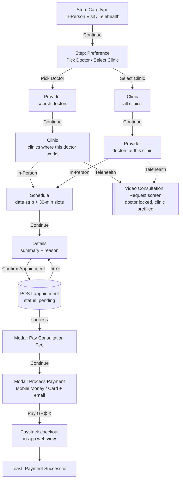

# Appointment Booking — Mockup Spec for the DigCare Website

> **What this is:** a screen-by-screen spec of the patient appointment booking flow in the DigCare mobile app, written so that **Claude Design** can produce accurate phone-screen mockups for the DigCare website (digcaregh.com).
>
> **Source of truth (mobile repo `digitalcare-mobile`):**
> - `app/appointment/patients/MultiStepAppointmentBooking.tsx`: the booking wizard (flow, copy, logic)
> - `styles/appointment/patients/MultiStepAppointmentBooking.styles.ts`: every colour, size and radius used below
> - `app/appointment/patients/GenerateBill.tsx` and `app/payment/ProcessPayment.tsx`: what happens after "Confirm Appointment"
> - `app/video-consultation/create.tsx`: where Telehealth bookings are handed off
>
> **Rule for the mockups:** show what the app actually does. Where the app has a quirk that would look odd on a marketing page, section 11 says what to show instead, so the mockup stays truthful without showing a glitch.

---

## Table of Contents

1. [Brief for Claude Design (copy-paste prompt)](#1-brief-for-claude-design-copy-paste-prompt)
2. [The Flow at a Glance](#2-the-flow-at-a-glance)
3. [Design Tokens (exact values from the app)](#3-design-tokens-exact-values-from-the-app)
4. [Persistent Screen Shell (header, progress bar, step rail)](#4-persistent-screen-shell)
5. [Screen-by-Screen Spec](#5-screen-by-screen-spec)
6. [After Confirmation: Bill and Payment](#6-after-confirmation-bill-and-payment)
7. [Telehealth Hand-off](#7-telehealth-hand-off)
8. [States: loading, empty, disabled, error](#8-states-loading-empty-disabled-error)
9. [Sample Data for the Mockups](#9-sample-data-for-the-mockups)
10. [Website Storyboards (which frames to make)](#10-website-storyboards-which-frames-to-make)
11. [Accuracy Notes: app quirks and what to show](#11-accuracy-notes-app-quirks-and-what-to-show)
12. [Where the Current Website Copy Differs from the App](#12-where-the-current-website-copy-differs-from-the-app)
13. [Icon Mapping (Ionicons → Lucide)](#13-icon-mapping-ionicons--lucide)
14. [Final Checklist](#14-final-checklist)

---

## 1. Brief for Claude Design (copy-paste prompt)

Paste this into Claude Design together with this file:

```
Create a set of high-fidelity mobile phone mockups (390 × 844, iPhone-style frame,
dark UI) of the DigCare patient "Book Appointment" flow, for use on the DigCare
marketing website. Follow appointment_mockup.md exactly:

- Use the app palette in section 3 (deep navy #0B1120 canvas, slate cards #1E293B,
  emerald #10B981 primary, violet #8B5CF6 for telehealth/avatars, teal #14B8A6 for
  completed steps). The app UI is dark-only.
- Headings in Space Grotesk 700, everything else in Manrope.
- Every screen has the shell from section 4: back button, "STEP X OF Y" pill,
  centred title and subtitle, a 3px emerald progress bar and a labelled step rail.
- Build the frames listed in section 10 ("Primary storyboard": 6 frames), using
  the sample data in section 9 and the exact copy in section 5.
- Present the frames on the website's own background (near-black navy #040415 with
  a subtle cyan #00EAFF glow), side by side or slightly overlapping, with a short
  caption under each frame (captions in section 10).
- Do not invent features that are not in this spec (no maps, no ratings, no
  distance filters, no reschedule buttons).
```

**Output targets on the site.** The homepage feature card already expects six screens named `BookAppointmentComp1.png`–`BookAppointmentComp6.png` (see `src/components/sections/FeaturesSection.tsx`). The patient feature page `/roles/patients/appointments` uses the accent `#10B981`, which is the same emerald the app uses, so these mockups drop straight in.

---

## 2. The Flow at a Glance

The screen is a single-page wizard. One component swaps its body depending on `currentStep`. The patient makes **two choices up front** (care type, then whether to start from a doctor or a clinic), and those two choices decide the rest of the route.

### 2.1 The four possible routes

| Care type | Preference | Steps shown in the step rail | Ends with |
|---|---|---|---|
| **In-Person Visit** | **Pick Doctor** | Care type → Preference → Provider → Clinic → Schedule → Details | Confirm → Pay Consultation Fee → Payment |
| **In-Person Visit** | **Select Clinic** | Care type → Preference → Clinic → Provider → Schedule → Details | Confirm → Pay Consultation Fee → Payment |
| **Telehealth** | **Pick Doctor** | Care type → Preference → Provider → Clinic | Jumps to **Request Video Consultation** screen |
| **Telehealth** | **Select Clinic** | Care type → Preference → Clinic → Provider | Jumps to **Request Video Consultation** screen |

In-person bookings have **6 steps**. Telehealth bookings have **4 steps** inside this wizard, then hand off to the video consultation screen (section 7).

### 2.2 Flow diagram



### 2.3 Back-button behaviour

The round back button in the header always steps back one screen along the chosen route. It also **clears the choice made on the screen you leave**:

| From | Goes to | Clears |
|---|---|---|
| Preference | Care type | preference |
| Provider (doctor-first) | Preference | selected doctor |
| Clinic (doctor-first) | Provider | selected clinic |
| Clinic (clinic-first) | Preference | selected clinic |
| Provider (clinic-first) | Clinic | selected doctor |
| Schedule | Clinic (doctor-first) or Provider (clinic-first) | nothing |
| Details | Schedule | nothing |
| Care type | leaves the booking screen | — |

### 2.4 What gets sent when the patient confirms

```json
{
  "doctor": "<doctor id>",
  "facility_id": "<clinic id>",
  "appointment_type": "in_person",
  "scheduled_at": "2026-10-16T10:30:00.000Z",
  "duration_minutes": 30,
  "reason": "Persistent headaches for the past week…",
  "status": "pending"
}
```

Every appointment is **30 minutes**, and it is created as **pending**. Payment comes right after.

---

## 3. Design Tokens (exact values from the app)

The app's booking screen is **dark-only**. The style file defines "dark" variants, but they resolve to the same values as the defaults, so the screen looks identical in light and dark system modes. Mock it dark.

### 3.1 Colour palette

| Token | Hex | Used for |
|---|---|---|
| `canvas` | `#0B1120` | Screen background, header, step rail, text on emerald buttons |
| `underlay` | `#0F172A` | Back button, search field, reason textarea, empty-state panel, icon wells |
| `section` | `#1A2234` | Background of a **selected** card |
| `card` | `#1E293B` | Cards, date chips, time chips; also the progress track and dividers (`divider`) |
| `border` | `#334155` | 1px borders on cards, chips, inputs, back button |
| `text` | `#F8FAFC` | Primary text |
| `muted` | `#94A3B8` | Subtitles, descriptions, labels, placeholder-ish text |
| `faint` | `#64748B` | Inactive step-rail labels, muted icons |
| `primary` (emerald) | `#10B981` | Buttons, progress bar, selected borders, selected date/time fill, active step dot, accent icons |
| `primarySoft` | `#064E3B` | Step pill, "Selected" badge, fee pill, insurance chip, summary icon wells, clinic icon well |
| `primaryBright` | `#34D399` | Text/icons on `primarySoft` (step pill text, "Selected", fee, insurance chip) |
| `violet` | `#8B5CF6` | Telehealth icon, "Pick Doctor" icon |
| `violetSoft` | `#2E1065` | Doctor avatar background, "Video" pill |
| `violetBright` | `#C4B5FD` | Avatar initials, "Video" pill text/icon |
| `teal` | `#14B8A6` | Completed step dots, the small status dot in the header |
| `tealSoft` | `#134E4A` | "Clinic" pill background |
| `tealBright` | `#5EEAD4` | "Clinic" pill text/icon |
| `danger` | `#EF4444` | Required asterisk, error border, inline error text |
| `dangerSoft` | `#450A0A` | Submit-error banner background (border `rgba(248,113,113,0.35)`, text `#FCA5A5`) |

Translucent borders used on soft pills: emerald `rgba(52,211,153,0.25–0.35)`, violet `rgba(196,181,253,0.25–0.28)`, teal `rgba(94,234,212,0.25)`.

Loading spinners in the lists are blue `#3B82F6` (the only blue on the screen).

### 3.2 Typography

| Role | Font | Size / line-height | Weight | Notes |
|---|---|---|---|---|
| Screen title | Space Grotesk | 20 / 27 | 700 | Centred |
| Screen subtitle | Manrope | 12 / 18 | 400 | Centred, `muted` |
| Step pill ("STEP 1 OF 6") | Manrope | 10 | 800 | UPPERCASE, letter-spacing 0.4 |
| Step meta label ("CARE TYPE") | Manrope | 11 | 700 | UPPERCASE, letter-spacing 0.4, `muted` |
| Step-rail label | Manrope | 9 / 12 | 700 | `faint`, becomes `text` when active/complete |
| Option-card title | Space Grotesk | 20 / 27 | 700 | |
| Option-card description | Manrope | 14 / 21 | 400 | `muted` |
| Doctor / clinic name | Space Grotesk | 16 / 24 | 700 | |
| Specialty / address | Manrope | 13 / 20 | 400 | `muted` |
| Pill text (fee, Video, Clinic, insurer) | Manrope | 11 / 16 | 800 | |
| Section title ("Available Dates") | Space Grotesk | 16 / 24 | 700 | |
| Date chip: weekday | Manrope | 11 | 800 | UPPERCASE |
| Date chip: day number | Space Grotesk | 21 / 28 | 800 | |
| Date chip: month | Manrope | 11 | 700 | |
| Time chip | Manrope | 14 | 800 | |
| Summary label ("DOCTOR") | Manrope | 11 | 800 | UPPERCASE, letter-spacing 0.4 |
| Summary value | Manrope | 14 / 22 | 700 | |
| Button text ("Continue") | Manrope | 15 | 900 | Colour `canvas` (dark text on emerald) |
| Submit text ("Confirm Appointment") | Manrope | 16 | 900 | Colour `canvas` |
| Input / textarea | Manrope | 15 (/24 textarea) | 400 | |

Both fonts are already loaded on the website (`globals.css` imports Space Grotesk and Manrope).

### 3.3 Shape, spacing and elevation

| Element | Radius | Padding | Other |
|---|---|---|---|
| Option card (type / preference) | 18 | 22 | min-height 168, drop shadow |
| Doctor card, clinic card, summary card | 16 | 16 | 12 gap between cards |
| Date chip | 16 | 12 v / 13 h | min-width 74, 10 gap |
| Time chip | pill (999) | 12 v / 14 h | min-width 92, 10 gap, wraps |
| Search field | 14 | 0 / 14 h | min-height 50 |
| Reason textarea | 16 | 16 | min-height 156 |
| Primary button | 14 | 0 / 18 h | height 54 (Continue), 56 (Confirm) |
| Pills, badges, icon wells, avatars | 999 (circle/pill) | 5 v / 9 h for pills | |
| Screen gutters | — | 16 left/right, 14 top/bottom | |

**Shadows**
- Option cards: `0 8px 18px rgba(2,6,23,0.22)`.
- Selected cards and emerald buttons: an **emerald glow**, `0 0 14–16px rgba(16,185,129,0.18–0.28)`.
- Active step dot: emerald glow `0 0 12px rgba(16,185,129,0.35)`.

**Disabled:** buttons drop to **45% opacity**. Unavailable date chips drop to **35% opacity** with their text at a further 45%.

---

## 4. Persistent Screen Shell

Every step uses the same top section. Only the body changes.

```
┌──────────────────────────────────────────┐
│ (status bar ~25px)                        │
│                                           │
│  (←)     [STEP 3 OF 6] • PROVIDER         │  ← meta row
│              Select Provider              │  ← title
│   Choose your preferred healthcare        │  ← subtitle
│               provider                    │
├──────────────────────────────────────────┤  ← 1px divider #1E293B
│████████████████████░░░░░░░░░░░░░░░░░░░░░░│  ← 3px progress bar
│  ✓        ✓        ●        ○      ○    ○ │  ← step rail dots
│ Care    Prefer-  Provider Clinic Sched- Details
│ type    ence                      ule     │
├──────────────────────────────────────────┤
│                                           │
│               STEP BODY                   │
│                                           │
└──────────────────────────────────────────┘
```

### 4.1 Header
- **Back button:** 42 × 42 circle, `underlay` fill, 1px `border`, left arrow icon 22px in `text` colour.
- **Meta row** (centred, 7px gap):
  - **Step pill:** `primarySoft` background, `primaryBright` text, "STEP {n} OF {total}".
  - **Status dot:** 5 × 5 `teal` circle.
  - **Step label:** uppercase short label of the current step (`muted`).
- **Title** and **subtitle** centred below (copy per step in section 5).
- A 42px invisible spacer on the right keeps the title centred.
- Bottom border 1px `divider`.

### 4.2 Progress bar
- Full-width 3px track in `divider` (`#1E293B`).
- Emerald fill, width = `(current step number ÷ total steps) × 100%`.
  - In-person: 16.7% → 33.3% → 50% → 66.7% → 83.3% → 100%.
  - Telehealth: 25% → 50% → 75% → 100%.

### 4.3 Step rail
One item per step in the route, spread evenly across the width (16px gutters).

| State | Dot (18 × 18 circle) | Label |
|---|---|---|
| **Completed** (before current) | `teal` fill + border, small dark check mark (10px, `#0B1120`) | `text` (white) |
| **Active** (current) | `primary` emerald fill + border, emerald glow, no icon | `text` (white) |
| **Upcoming** | `underlay` fill, 1px `border` | `faint` |

Rail labels (short names):

| Step id | Rail / meta label |
|---|---|
| `type` | Care type |
| `path` | Preference |
| `doctor` | Provider |
| `clinic` | Clinic |
| `clinic_doctors` | Provider |
| `datetime` | Schedule |
| `reason` | Details |

---

## 5. Screen-by-Screen Spec

Copy in quotes is the exact text the app shows. `{…}` marks live data.

---

### Screen 1 — Care type

| | |
|---|---|
| Meta | STEP 1 OF {n} • CARE TYPE |
| Title | "Select Appointment Type" |
| Subtitle | "Choose how you'd like to consult" |

**Body:** two large option cards stacked vertically and **centred vertically** in the free space (14px gap), then a full-width **Continue** button at the bottom.

```
┌──────────────────────────────────────┐
│  ( 🏢 )                               │  52px icon well, emerald building icon
│                                       │
│  In-Person Visit                      │  Space Grotesk 20
│  Visit the clinic for face-to-face    │  Manrope 14, muted
│  consultation                         │
│                                       │
│  [✓ Selected]                         │  only when selected
└──────────────────────────────────────┘
┌──────────────────────────────────────┐
│  ( 🎥 )                               │  violet video icon
│  Telehealth                           │
│  Consult with your doctor online via  │
│  video call                           │
└──────────────────────────────────────┘

[            Continue            ]
```

| Card | Icon (30px, inside 52px `underlay` circle with border) | Title | Description |
|---|---|---|---|
| In-person | building, **emerald** `#10B981` | "In-Person Visit" | "Visit the clinic for face-to-face consultation" |
| Telehealth | video camera, **violet** `#8B5CF6` | "Telehealth" | "Consult with your doctor online via video call" |

**Selected card:** background `#1A2234`, 1px emerald border, emerald glow, plus a **"Selected" badge** under the description: pill, `primarySoft` fill, emerald translucent border, check-circle icon 14px `#34D399`, text "Selected" (12/800, `#34D399`).

**Continue:** disabled (45% opacity) until a card is picked.

---

### Screen 2 — Preference

| | |
|---|---|
| Meta | STEP 2 OF {n} • PREFERENCE |
| Title | "Choose Your Preference" |
| Subtitle | "Would you like to choose a doctor or clinic first?" |

**Body:** same layout and card style as Screen 1.

| Card | Icon | Title | Description |
|---|---|---|---|
| Doctor first | person-plus, **violet** | "Pick Doctor" | "Choose your preferred doctor, then select a clinic" |
| Clinic first | building, **emerald** | "Select Clinic" | "Choose your preferred clinic, then pick a doctor" |

Selected state and Continue behaviour match Screen 1.

---

### Screen 3a — Provider (doctor-first route)

| | |
|---|---|
| Meta | STEP 3 OF {n} • PROVIDER |
| Title | "Select Provider" |
| Subtitle | "Choose your preferred healthcare provider" |

**Body, top to bottom:**

1. **Search field.** `underlay` fill, 1px border, radius 14, height 50. Search icon 18px `#64748B`, placeholder **"Search by name or specialty..."**.
   - The search hits the server **400 ms after the patient stops typing**. A blue spinner shows while it runs.
   - Results are **filtered to doctors who offer the chosen care type** (in-person doctors for In-Person, online doctors for Telehealth).
2. **Scrollable list of doctor cards** (see 5.1 below).
3. **Continue** button, disabled until a doctor is selected.

Before anything is typed, the list usually shows the empty prompt **"Search for a doctor by name or specialty"** (see section 8). For the website, show the screen **with a search term typed and results visible**.

#### 5.1 Doctor card anatomy (shared by both Provider screens)

```
┌──────────────────────────────────────────────┐
│ ┌────┐  Dr. Kwame Mensah                (✓)  │
│ │ KM │  Internal Medicine                    │
│ └────┘  [₵ GHS 150] [🎥 Video] [🏢 Clinic]    │
│         📍 Osu Wellness Clinic               │
└──────────────────────────────────────────────┘
```

| Part | Spec |
|---|---|
| Card | `card` fill, 1px `border`, radius 16, padding 16, row layout, items centred |
| Avatar | 52px circle, `violetSoft` fill, 1px violet translucent border. Shows the profile photo if present; otherwise **initials** (Space Grotesk 16/800, `#C4B5FD`) |
| Name | "Dr. {first_name} {last_name}" (Space Grotesk 16/700) |
| Specialty | "{specialty}" or **"General Practice"** if empty (Manrope 13, `muted`) |
| Pills row (wraps, 6px gap) | **Fee pill** (always): cash icon, emerald soft, text **"GHS {fee}"** or **"Fee on request"**. **"Video"** pill (violet soft, video icon) only if the doctor offers online. **"Clinic"** pill (teal soft, building icon) only if the doctor offers in-person |
| Location line | Only if the doctor record has a facility: pin icon 13px + facility text (Manrope 12, `muted`) |
| Selected | Card turns `#1A2234` with emerald border and glow; a **32px emerald circle with a dark check mark** appears on the right |

---

### Screen 3b — Clinic (doctor-first route)

| | |
|---|---|
| Meta | STEP 4 OF {n} • CLINIC |
| Title | "Select Clinic" |
| Subtitle | "Select clinic for Dr. {first} {last}" |

**Body:**

1. **Context summary card** (top): emerald person icon in a 34px `primarySoft` circle, then:
   - "Dr. {first} {last}" (Manrope 14/700)
   - "{N} clinic(s) available" (13, `muted`)
2. **List of clinic cards**, filtered to **clinics where this doctor works** (from the doctor's clinic list, or else from their active shifts).
3. **Continue**, disabled until a clinic is picked.

Telehealth note: on this route, pressing Continue here **leaves the wizard** for the video consultation screen (section 7). In-person continues to Schedule.

#### 5.2 Clinic card anatomy (shared by both Clinic screens)

```
┌──────────────────────────────────────────────┐
│ ( 🏢 )  Osu Wellness Clinic              (✓)  │
│         12 Oxford Street, Osu, Accra         │
│                                              │
│         COVERED BY YOUR INSURANCE            │
│         [🛡 NHIS]                            │
└──────────────────────────────────────────────┘
```

| Part | Spec |
|---|---|
| Card | Same as doctor card: `card` fill, 1px border, radius 16, padding 16, row |
| Icon | 50px circle, `primarySoft` fill, emerald translucent border, emerald building icon 24px |
| Name | Space Grotesk 16/700 |
| Address | Only if present: Manrope 13/20, `muted` |
| Insurance block | **Only shown when the clinic accepts the patient's own insurer.** Label "COVERED BY YOUR INSURANCE" (11/800 uppercase, `muted`), then one chip per matching insurer: shield-check icon 12px `#34D399`, insurer name (11/800 `#34D399`) on `primarySoft` |
| Selected | Same as doctor card: `#1A2234`, emerald border + glow, 32px emerald check circle |

---

### Screen 3c — Clinic (clinic-first route)

| | |
|---|---|
| Meta | STEP 3 OF {n} • CLINIC |
| Title | "Select Clinic" |
| Subtitle | "Choose your preferred location" |

**Body:** no summary card, just the full list of clinic cards (5.2) and **Continue**.

---

### Screen 3d — Provider (clinic-first route)

| | |
|---|---|
| Meta | STEP 4 OF {n} • PROVIDER |
| Title | "Select Provider" |
| Subtitle | "Available providers at {clinic name}" |

**Body:**

1. **Context summary card:** emerald map-pin icon in a 34px `primarySoft` circle, then:
   - "{clinic name}" (14/700)
   - "{N} doctor(s) available" (13, `muted`)
2. **No search field** on this route.
3. **List of doctor cards** (5.1), showing the doctors attached to that clinic (or, failing that, doctors with active shifts there).
4. **Continue**, disabled until a doctor is picked.

Telehealth note: Continue here **leaves the wizard** for the video consultation screen (section 7). In-person continues to Schedule.

---

### Screen 4 — Schedule (in-person only)

| | |
|---|---|
| Meta | STEP 5 OF 6 • SCHEDULE |
| Title | "Select Date & Time" |
| Subtitle | "Choose your preferred appointment slot" |

**Body (scrolls), then a fixed footer with Continue:**

```
┌──────────────────────────────────────────┐
│ (👤) Dr. Kwame Mensah                     │  summary card
│ (📍) Osu Wellness Clinic                  │
└──────────────────────────────────────────┘

Available Dates
┌────┐ ┌────┐ ┌────┐ ┌────┐ ┌────┐ ┌────┐ →  horizontal scroll
│WED │ │THU │ │FRI │ │SAT │ │SUN │ │MON │
│ 14 │ │ 15 │ │ 16 │ │ 17 │ │ 18 │ │ 19 │
│Oct │ │Oct │ │Oct │ │Oct │ │Oct │ │Oct │
└────┘ └────┘ └────┘ └────┘ └────┘ └────┘
 avail  faded  SELECTED faded faded avail

Available Times
(9:00 AM) (9:30 AM) (10:00 AM)
(10:30 AM)(11:00 AM)(11:30 AM)            ← 10:30 selected = emerald fill
(12:00 PM)(12:30 PM)

[              Continue              ]
```

1. **Summary card:** two rows, each a 34px `primarySoft` circle with an emerald icon (person, then map pin) + the doctor name and the clinic name (14/700).
2. **"Available Dates"** section title, then a **horizontal strip of 30 date chips starting today**.
   - Chip: weekday (e.g. "WED"), day number (e.g. "14"), month (e.g. "Oct").
   - A date is **available** only if the chosen doctor has an **active shift at the chosen clinic on that weekday**. Unavailable dates are faded to 35% and can't be tapped.
   - **Selected** date chip: solid emerald fill, all text dark (`#0B1120`).
3. **"Available Times"** section title (20px space above), then **pill-shaped time chips** that wrap, 10px gap.
   - Slots are generated **every 30 minutes** from the shift's start time up to (not including) its end. A 09:00–13:00 shift gives 9:00 AM … 12:30 PM (8 slots).
   - If a doctor has two shifts that day, two groups of chips are shown one after the other.
   - **Selected** slot: solid emerald fill, dark text.
   - Times display as "9:00 AM", "12:30 PM".
4. **Footer:** **Continue**, disabled when the selected date has no shifts.

If the selected date has no shifts, the times area shows an empty state: calendar icon in a 58px circle and **"No available time slots for this date"**.

---

### Screen 5 — Details (in-person only)

| | |
|---|---|
| Meta | STEP 6 OF 6 • DETAILS |
| Title | "Consultation Details" |
| Subtitle | "Tell us why you're visiting" |

```
┌──────────────────────────────────────────┐
│ (👤) DOCTOR                               │
│      Dr. Kwame Mensah                     │
│ (📍) LOCATION                             │
│      Osu Wellness Clinic                  │
│ (📅) DATE & TIME                          │
│      Friday, October 16 at 10:30 AM       │
└──────────────────────────────────────────┘

Consultation Reason *
┌──────────────────────────────────────────┐
│ I've had persistent headaches for the    │
│ past week, mostly in the afternoons…     │
│                                           │
│                                           │
└──────────────────────────────────────────┘

[         Confirm Appointment          ]
```

1. **Appointment summary card**, three rows. Each row: 34px `primarySoft` icon circle (emerald person / map pin / calendar) + an uppercase label (11/800 `muted`) over the value (14/700 white):
   - **DOCTOR**: "Dr. {first} {last}"
   - **LOCATION**: "{clinic name}"
   - **DATE & TIME**: "{Weekday}, {Month} {day} at {h:mm AM/PM}", e.g. "Friday, October 16 at 10:30 AM"
2. **"Consultation Reason"** section title with a red **\*** (`#EF4444`).
3. **Textarea:** `underlay` fill, 1px border, radius 16, min-height 156, placeholder **"Describe your symptoms or reason for the appointment..."**.
4. **Confirm Appointment** button: emerald, height 56, radius 14, emerald glow, text "Confirm Appointment" (16/900, dark). While submitting, the label is replaced by a white spinner and the button fades to 45%.

**Validation:** if the reason is empty, pressing the button shows the red submit banner **"Please complete all required fields"** (section 8).

On success, the **Pay Consultation Fee** modal slides up (section 6).

---

## 6. After Confirmation: Bill and Payment

Once the appointment is created (status **pending**), the patient goes straight into paying the consultation fee. This part uses its own modal styling, slightly different from the wizard.

### 6.1 Modal A — "Pay Consultation Fee"

Bottom sheet that slides up over a near-opaque dark overlay (`rgba(10,15,30,0.95)`). Sheet background `#0A0F1E`, cards `#1A2332`, borders `#2A3547`, text `#E8EAF0`, secondary text `#9CA3BC`.

```
┌──────────────────────────────────────────┐
│ Pay Consultation Fee                  (×) │
├──────────────────────────────────────────┤
│ ┌──────────────────────────────────────┐ │
│ │ Appointment Summary                   │ │
│ │ Doctor                                │ │
│ │ Dr. Kwame Mensah                      │ │
│ │ Clinic                                │ │
│ │ Osu Wellness Clinic                   │ │
│ │ Type                                  │ │
│ │ In-Person                             │ │
│ │ Scheduled                             │ │
│ │ Oct 16, 2026, 10:30 AM                │ │
│ └──────────────────────────────────────┘ │
├──────────────────────────────────────────┤
│ [  Cancel  ]      [ 💳 Continue ]         │
└──────────────────────────────────────────┘
```

- Title: **"Pay Consultation Fee"**, round close button "×".
- **Appointment Summary** card: labels **Doctor / Clinic / Type / Scheduled**. Type reads **"In-Person"** or **"Telehealth"**. Scheduled format: "Oct 16, 2026, 10:30 AM".
- Footer: **Cancel** (outlined) and **💳 Continue** (emerald). While the bill is generated: spinner + **"Processing..."**.
- If a bill already exists for this appointment, a system alert **"Bill Already Exists"** offers **View Bill** / **Cancel**.

### 6.2 Modal B — "Process Payment"

Opens after the bill is generated (Modal A closes).

```
┌──────────────────────────────────────────┐
│ 💳 Process Payment                    (✕) │
│ Bill: BILL-2026-00418                     │
├──────────────────────────────────────────┤
│ PAYMENT SUMMARY                           │
│ Service Amount              GH₵ 150.00    │
│ Platform Fee                GH₵ 7.50      │
│ 🏥 Insurance Covered      - GH₵ 0.00      │  ← only if > 0
│ ───────────────────────────────────────── │
│ Total Amount                GH₵ 157.50    │
│                                           │
│ Payment Method                            │
│ [ 📱 Mobile Money ]  [ 💳 Card Payment ]   │  ← Mobile Money selected by default
│                                           │
│ Email Address *                           │
│ [ your.email@example.com              ]   │
├──────────────────────────────────────────┤
│ [  Cancel  ]      [ 💳 Pay GH₵ 157.50 ]   │
└──────────────────────────────────────────┘
```

- **PAYMENT SUMMARY:** Service Amount, Platform Fee, **Insurance Covered** (green, shown only when insurance pays part), divider, **Total Amount** (emerald).
- **Payment Method:** two toggle buttons, **Mobile Money** (default) and **Card Payment**.
- **Email Address \***, placeholder "your.email@example.com".
- Primary button: **"Pay GH₵ {total}"**; shows "Processing..." while starting.

### 6.3 Checkout and confirmation

- Pressing Pay opens **Paystack checkout inside the app** (full-screen web view). Header: back arrow, **"Complete Payment"**, the amount underneath. While loading: spinner + **"Loading payment page..."**.
- On success, an emerald toast drops in: **"Payment Successful!"** / "Your payment of GH₵ {total} was processed successfully".

For the website, a single frame of Modal B (Mobile Money selected) tells this story well. Do not mock the Paystack page itself, since it is a third-party screen.

---

## 7. Telehealth Hand-off

For **Telehealth**, the wizard stops after the patient has a doctor **and** a clinic. There is no Schedule or Details step. Pressing **Continue** opens the **Video Consultation: Request** screen (`/video-consultation/create`) with:

- the chosen **doctor pre-selected and locked** (can't be changed),
- the chosen **clinic pre-filled**,
- a **"Request Consultation"** button to send the request.

So on the website, the Telehealth story is: *Care type (Telehealth) → Preference → Provider → Clinic → Request Consultation*. The step rail for this route shows **4 steps**: Care type, Preference, Provider, Clinic (or Clinic, Provider).

---

## 8. States: loading, empty, disabled, error

### 8.1 Loading
- Doctor and clinic lists: large **blue spinner** (`#3B82F6`) 40px from the top of the list.
- Confirm button: label replaced by a white spinner.

### 8.2 Empty states
All empty states share one panel: `underlay` fill, 1px `divider` border, radius 18, 44px vertical padding, centred. Inside: a 58px `card` circle with a 30px muted icon, then text (Manrope 15/22, `muted`, centred).

| Where | Icon | Text |
|---|---|---|
| Provider, doctor-first, nothing typed | medical | "Search for a doctor by name or specialty" |
| Provider, doctor-first, no matches | medical | "No doctors found matching your search" |
| Provider, clinic-first, none at clinic | medical | "No doctors available at {clinic}" |
| Clinic, doctor-first, none | building | "No clinics available for Dr. {first} {last}" |
| Clinic, clinic-first, none | building | "No clinics available" |
| Schedule, date has no shifts | calendar | "No available time slots for this date" |

### 8.3 Disabled
- **Continue** is disabled (45% opacity) until the step's choice is made: care type, preference, doctor, clinic, or (on Schedule) a date that has shifts.
- Unavailable date chips: 35% opacity, not tappable.

### 8.4 Errors
- **Submit error banner** (Details screen, above the button): `#450A0A` fill, border `rgba(248,113,113,0.35)`, radius 14, padding 12, centred text 14/700 `#FCA5A5`.
  - Missing reason: **"Please complete all required fields"**.
  - Server error: the server's message, or **"Failed to book appointment. Please try again."**

---

## 9. Sample Data for the Mockups

All names below are **fictional placeholders** for the mockups. Replace them with approved provider names only if DigCare has permission to show them.

**Today in the mockups:** Wednesday, 14 October 2026.

### 9.1 Doctors

| Initials | Name | Specialty | Fee | Video | Clinic | Facility line |
|---|---|---|---|---|---|---|
| KM | Dr. Kwame Mensah | Internal Medicine | GHS 150 | ✓ | ✓ | Osu Wellness Clinic |
| AA | Dr. Abena Asante | Paediatrics | GHS 120 | ✓ | ✓ | Airport Hills Medical Centre |
| YB | Dr. Yaw Boateng | General Practice | Fee on request | — | ✓ | Legon Family Health |
| EO | Dr. Efua Owusu | Dermatology | GHS 200 | ✓ | — | — |

Search term to show in the field: **"Mensah"** or **"Internal"**. Selected doctor: **Dr. Kwame Mensah**.

### 9.2 Clinics

| Name | Address | Insurance chips |
|---|---|---|
| Osu Wellness Clinic | 12 Oxford Street, Osu, Accra | NHIS |
| Airport Hills Medical Centre | 4 Liberation Road, Airport Residential, Accra | NHIS, Premier Health Cover |
| Legon Family Health | East Legon, Accra | *(none, so no insurance block)* |

Selected clinic: **Osu Wellness Clinic**. Summary line on the doctor-first clinic screen: "2 clinics available".

### 9.3 Schedule

Dr. Mensah at Osu Wellness Clinic works **Monday, Wednesday and Friday, 09:00–13:00**.

| Wed 14 | Thu 15 | Fri 16 | Sat 17 | Sun 18 | Mon 19 | Tue 20 | Wed 21 |
|---|---|---|---|---|---|---|---|
| available | faded | **selected** | faded | faded | available | faded | available |

Time slots: 9:00 AM, 9:30 AM, 10:00 AM, **10:30 AM (selected)**, 11:00 AM, 11:30 AM, 12:00 PM, 12:30 PM.

### 9.4 Details and payment

- Reason: *"I've had persistent headaches for the past week, mostly in the afternoons. Paracetamol helps a little but they keep coming back."*
- Summary date: **"Friday, October 16 at 10:30 AM"**.
- Bill modal "Scheduled": **"Oct 16, 2026, 10:30 AM"**.
- Bill: **BILL-2026-00418**, Service Amount **GH₵ 150.00**, Platform Fee **GH₵ 7.50** (illustrative; the real fee comes from the server), Total **GH₵ 157.50**.
- Insurance variant: Insurance Covered **- GH₵ 120.00**, Total **GH₵ 37.50**.

---

## 10. Website Storyboards (which frames to make)

### 10.1 Primary storyboard — In-person, doctor first (6 frames → `BookAppointmentComp1–6.png`)

| # | Frame | Header | What's on screen | Caption for the website |
|---|---|---|---|---|
| 1 | Care type | STEP 1 OF 6 • CARE TYPE | Both cards, **In-Person Visit selected**, Continue enabled | **Choose how you want to be seen.** In person at a clinic, or by video from home. |
| 2 | Preference | STEP 2 OF 6 • PREFERENCE | **Pick Doctor selected**; rail: 1 done, 2 active | **Start with a doctor or a clinic.** Book the way that suits you. |
| 3 | Provider | STEP 3 OF 6 • PROVIDER | Search "Mensah", 2–3 doctor cards, **Dr. Kwame Mensah selected** | **Find the right provider.** Search by name or specialty and see fees up front. |
| 4 | Clinic | STEP 4 OF 6 • CLINIC | Summary "Dr. Kwame Mensah · 2 clinics available", **Osu Wellness Clinic selected** with NHIS chip | **See where your insurance is accepted.** Clinics that take your insurer are marked. |
| 5 | Schedule | STEP 5 OF 6 • SCHEDULE | Summary card, date strip with **Fri 16 selected**, 8 slots with **10:30 AM selected** | **Pick a real open slot.** Only days your doctor is at the clinic can be booked. |
| 6 | Details | STEP 6 OF 6 • DETAILS | Full summary card, reason typed, **Confirm Appointment** | **Tell your doctor why you're coming.** Then confirm in one tap. |

### 10.2 Optional extra frames

| Frame | Use it for | Notes |
|---|---|---|
| **Pay Consultation Fee** (6.1) | Insurance & payments sections, or a 7th booking frame | Shows summary before paying |
| **Process Payment** (6.2), Mobile Money selected | "Pay with Mobile Money" messaging | Use the insurance variant to show coverage |
| **Telehealth: Care type** with Telehealth selected | Video Consultation feature card | Step pill reads STEP 1 OF 4 |
| **Telehealth: Clinic step** | Video Consultation feature card | Rail shows 4 steps; Continue leads to "Request Consultation" |
| **Clinic-first: Provider** (3d) | Showing "start from your clinic" | Summary "Osu Wellness Clinic · 3 doctors available", no search bar |
| **Empty search state** | Not recommended for marketing | Only if explaining search |

### 10.3 Presentation on the website

- **Frame size:** 390 × 844 (iPhone 14/15 class). Rounded device frame with a thin bezel; keep the app's own 25px top inset for the status bar.
- **Background around the phones:** the site's navy `hsl(240 67% 5%)` ≈ `#040415`, with a soft **cyan** (`hsl(185 100% 50%)` ≈ `#00EAFF`) or **emerald** glow behind the active phone. On light sections (role pages use `#1a2b3c` text on light backgrounds), drop a soft shadow under the dark phones instead of a glow.
- **Inside the phone:** keep the app's emerald and navy. **Do not** recolour the app UI to the site's cyan, so the mockups match what patients will see.
- **Layout ideas:**
  - Homepage feature card: overlapping fan of 3 phones (frames 1, 3, 5) with frames 2, 4, 6 available in a carousel.
  - `/roles/patients/appointments`: a horizontal stepper (the site's `StepFlow` component) with one phone per step, using the captions above.
- **Alt text:** describe each frame on its own (e.g. "Booking step 5 of 6: choosing Friday 16 October at 10:30 AM with Dr. Kwame Mensah"), not "Appointment Booking" on every image.

---

## 11. Accuracy Notes: app quirks and what to show

These are real behaviours in the current code. The mockups should stay truthful, but they don't need to show a moment that looks broken.

| # | What the app does | What to show in the mockup |
|---|---|---|
| 1 | The step count only becomes final once both care type and preference are chosen. On first load the pill reads "STEP 1 OF 2"; picking Telehealth changes it to "OF 4"; picking In-Person keeps "OF 2" until a preference is chosen. | Show the **final** count for the route (6 for in-person, 4 for telehealth) on every frame. |
| 2 | On the doctor-first Provider step, the list starts empty with "Search for a doctor by name or specialty" because doctors are only loaded by searching. | Show a **search term typed** and results listed. |
| 3 | On the clinic-first route, the doctor list shows **all** of that clinic's doctors; it isn't filtered by the chosen care type. | Doesn't matter visually. Use doctors that offer the chosen type so the pills make sense. |
| 4 | The Schedule step starts on **today's date and the current time of day**, so Continue can be enabled without the patient tapping a slot, and today may appear selected even if it's unavailable. | Always show **a selected available date and a selected time slot**. |
| 5 | The doctor card fee says **"GHS 150"**, while the bill and payment modals use **"GH₵"**. | Keep each screen as the app has it. Optionally standardise to **GH₵** on both if the app is updated. |
| 6 | The Platform Fee line in Process Payment isn't formatted to 2 decimals (could read "GH₵ 7.5"). | Show **"GH₵ 7.50"**. |
| 7 | Telehealth skips Schedule and Details and goes to the Video Consultation request screen. | Never show a Schedule screen with Telehealth chosen. |
| 8 | The style file has light/dark variants, but both are dark. | Mock **dark only**. |
| 9 | The "Pay Consultation Fee" modal uses a slightly different dark palette (`#0A0F1E` / `#1A2332`) from the wizard (`#0B1120` / `#1E293B`). The "Process Payment" sheet has its own fixed dark theme: background `#0d1322`, cards `#191f2f`, borders `#3c4a42`, text `#dde2f8`, and a brighter emerald `#4edea3` (with dark `#003824` text) for the selected method and the Pay button. | Keep the differences subtle, or use the wizard palette for everything; it's not noticeable at website scale. If you mock Process Payment, use its brighter `#4edea3` Pay button. |

---

## 12. Where the Current Website Copy Differs from the App

The appointments page data in `src/app/roles/patients/_data/features.tsx` (slug `appointments`) says some things this booking screen doesn't do. Worth reviewing so the copy next to the new mockups matches them:

| Website says | The booking screen actually | Suggestion |
|---|---|---|
| Step 1 "Choose a facility or doctor", then Step 2 "Pick a slot… and whether you want an in-person visit or a teleconsult" | Asks **care type first**, then doctor-or-clinic, then slot | Reorder: 1) Choose in-person or video, 2) Pick a doctor or clinic, 3) Pick a slot, 4) Add your reason and pay |
| "Filter by distance, availability, or your insurance network" | Search by **name or specialty** only; clinics show an **insurance-covered badge** but there is no distance or filter control | "Search by name or specialty, and see which clinics accept your insurance" |
| "Your whole booking flow lives in one screen" | One screen, but a **step-by-step wizard** (4–6 steps) | Fine as is, or "a short step-by-step flow" |
| "Avg. time to book < 60 sec" | Not measured in the app | Keep only if there's data behind it |
| Teleconsults booked the same way as visits | Telehealth hands off to a **consultation request**; no slot is picked in this flow | Mention "request a video consultation with your chosen doctor" |
| Not mentioned | Payment of the consultation fee (Mobile Money or card) straight after confirming | Add a step: "Pay the consultation fee with Mobile Money or card" |
| Reminders, reschedule/cancel, visit history | Not part of this screen (may exist elsewhere in the app) | Keep if they exist elsewhere; just don't show them in these mockups |

---

## 13. Icon Mapping (Ionicons → Lucide)

The app uses Ionicons. The website uses `lucide-react`. Use these equivalents when recreating screens in HTML or describing them to Claude Design:

| Where | Ionicons (app) | Lucide (site) |
|---|---|---|
| Back button | `arrow-back` | `ArrowLeft` |
| In-Person / Select Clinic / clinic card / "Clinic" pill | `business-outline` | `Building2` |
| Telehealth / "Video" pill | `videocam-outline` | `Video` |
| Pick Doctor | `person-add-outline` | `UserPlus` |
| Selected badge | `checkmark-circle` | `CheckCircle2` |
| Selected indicator / completed step | `checkmark` | `Check` |
| Search | `search` | `Search` |
| Fee pill | `cash-outline` | `Banknote` |
| Location / clinic summary | `location-outline` | `MapPin` |
| Doctor summary | `person-outline` | `User` |
| Date summary / no-slots empty state | `calendar-clear-outline` | `Calendar` |
| Insurance chip | `shield-checkmark` | `ShieldCheck` |
| Doctor empty state | `medical-outline` | `Stethoscope` |

---

## 14. Final Checklist

Before exporting the mockups, check each frame:

- [ ] Dark navy canvas `#0B1120`, cards `#1E293B` with `#334155` borders.
- [ ] Space Grotesk for titles and names; Manrope for everything else.
- [ ] Header has: back button, "STEP X OF Y" emerald pill, teal dot, uppercase step label, centred title and subtitle with the exact copy from section 5.
- [ ] 3px emerald progress bar at the right percentage.
- [ ] Step rail: teal ticks for completed steps, glowing emerald dot for the current one, grey for upcoming, with labels.
- [ ] Selected cards: `#1A2234` fill + emerald border + glow (+ "Selected" badge on option cards, check circle on doctor/clinic cards).
- [ ] Buttons: emerald, dark text, "Continue" / "Confirm Appointment".
- [ ] Doctor cards: initials avatar in violet, "Dr." prefix, fee pill, Video/Clinic pills only where true.
- [ ] Clinic cards: insurance block only where the patient's insurer matches.
- [ ] Schedule: unavailable days faded, one date and one 30-minute slot selected.
- [ ] In-person route shows 6 steps; telehealth shows 4 and never shows Schedule or Details.
- [ ] No invented features (ratings, maps, distance, reschedule).
- [ ] Sample names are fictional placeholders (section 9).
- [ ] Each exported image has its own descriptive alt text.
