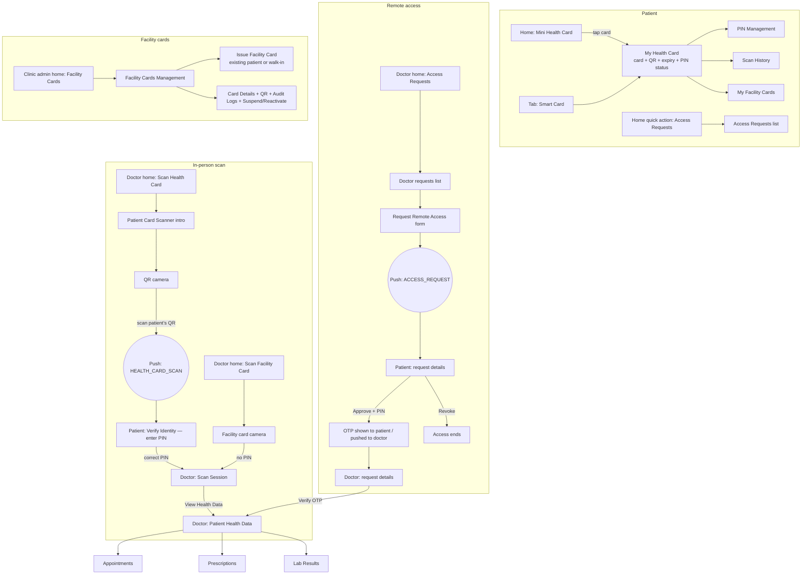

# Health Card & Access Control — Mockup Spec for the DigCare Website

> **What this is:** a complete, screen-by-screen spec of everything in the DigCare mobile app's `app/healthcard/` folder, written so that **Claude Design** can produce accurate phone-screen mockups for the DigCare website (digcaregh.com). It is the companion to `appointment_mockup.md` and `prescription_mockup.md`.
>
> The Health Card is not one screen. It is a **system of five connected flows used by four roles**:
>
> | # | Flow | Who uses it | Folder |
> |---|---|---|---|
> | A | **My Health Card**: the card, QR code, PIN, scan log | Patient | `MiniHealthCard.tsx`, `MyHealthCard.tsx`, `PinManagement.tsx`, `SetPin.tsx`, `ScanHistory.tsx` |
> | B | **In-person scan**: doctor scans the QR, patient approves with PIN | Doctor + Patient | `scan-session/` |
> | C | **Remote access**: doctor requests access, patient approves with PIN, doctor enters OTP | Doctor + Patient | `remote-access/` |
> | D | **Viewing health data**: what the doctor sees once access is granted | Doctor | `health-data/` |
> | E | **Facility cards**: clinic front desk issues clinic-specific cards | Clinic admin (+ patient view) | `facility-cards/` |
>
> **Source of truth (mobile repo `digitalcare-mobile`):** every file under `app/healthcard/`, the styles under `styles/healthcard/`, `services/healthcard/HealthCardService.ts` / `HealthCardTypes.ts` / `websockets/ScanSessionWebSocket.ts`, `store/healthcard/*`, plus entry points in `app/home/*`, `app/layouts/*`, `app/shared-components/BottomTabBar.tsx` and `app/notification/Notification.tsx`.
>
> **Rule for the mockups:** show what the app actually does. Colours listed here are the ones that **actually render** (inline colours override the style files in many screens). Section 14 lists app quirks and what to show instead.

---

## Table of Contents

1. [Brief for Claude Design (copy-paste prompt)](#1-brief-for-claude-design-copy-paste-prompt)
2. [The System at a Glance](#2-the-system-at-a-glance)
3. [Design Tokens (six palettes, what actually renders)](#3-design-tokens-six-palettes-what-actually-renders)
4. [Shared Chrome: tab bars and entry points](#4-shared-chrome-tab-bars-and-entry-points)
5. [Flow A — Patient: My Health Card](#5-flow-a--patient-my-health-card)
6. [Flow B — In-person Scan (doctor scans, patient approves)](#6-flow-b--in-person-scan-doctor-scans-patient-approves)
7. [Flow C — Remote Access (request, approve, OTP)](#7-flow-c--remote-access-request-approve-otp)
8. [Flow D — Doctor: Viewing Health Data](#8-flow-d--doctor-viewing-health-data)
9. [Flow E — Facility Cards](#9-flow-e--facility-cards)
10. [Notifications and System Dialogs](#10-notifications-and-system-dialogs)
11. [API Reference](#11-api-reference)
12. [Sample Data for the Mockups](#12-sample-data-for-the-mockups)
13. [Website Storyboards (which frames to make)](#13-website-storyboards-which-frames-to-make)
14. [Accuracy Notes: app quirks and what to show](#14-accuracy-notes-app-quirks-and-what-to-show)
15. [Where the Current Website Copy Differs from the App](#15-where-the-current-website-copy-differs-from-the-app)
16. [Icon Mapping (Ionicons / emoji → Lucide)](#16-icon-mapping-ionicons--emoji--lucide)
17. [Final Checklist](#17-final-checklist)

---

## 1. Brief for Claude Design (copy-paste prompt)

Paste this into Claude Design together with this file:

```
Create high-fidelity mobile phone mockups (390 × 844, iPhone-style frame, dark UI)
of the DigCare "Health Card" system for the DigCare marketing website. Follow
healthcard_mockup.md exactly:

- Each screen keeps its own palette from section 3. Patient card screens are deep
  navy #0B1120 with slate #1E293B cards and emerald #10B981. The patient's
  "approve scan" PIN screen is iOS-style black #000000 / #1C1C1E with #007AFF
  blue. Access-request screens are Material dark #1E1E1E with #42A5F5 blue and
  coloured status dots.
- The health card itself (section 5.2) is a diagonal gradient card
  (#0F172A → #0F766E for a Smart card), 24px radius, with a white chip, the
  cardholder name, card number in the format SMART-XXXX-XXXX, expiry, and a
  status pill. The QR code is shown separately below it on a white tile.
- Use the system sans-serif font (SF Pro look; Inter is an acceptable stand-in).
  The app never loads its intended Space Grotesk / Manrope fonts.
- Show the patient bottom tab bar (Home / Smart Card / Profile, emerald active
  pill) on patient screens, and the doctor tab bar (Appointments / Home /
  Profile) on doctor screens.
- Build the 3 frames in section 13.1 first, then any extra frames from 13.2,
  using the sample data in section 12 and the exact copy in sections 5–9.
- Present the phones on the website's navy background (#040415) with a soft
  emerald (#10B981) or cyan (#00EAFF) glow, each with its caption.
- Do not invent features: no "flag this access" button, no access scopes or
  "indefinite" access, no live countdown timers, no map, no offline badge,
  no Adult/Student/Visitor card types on the card face.
```

**Output targets on the site.**
- Homepage feature card "Digcare Health Card" uses **`DigcareHealthCardComp1–3.png`** (in `public/assets/`), so the primary storyboard is **three frames**.
- `src/components/sections/HealthCardSection.tsx` (homepage flagship section) currently draws its own illustrated card and an "Access activity" panel in code; section 15 lists what in it differs from the app.
- Patient feature pages: `/roles/patients/health-card` and `/roles/patients/access-control` (accent `#10B981`).
- Doctor and clinic-admin pages exist at `/roles/doctors` and `/roles/facility-admins`; frames from flows B, D and E suit those.

---

## 2. The System at a Glance

### 2.1 How the pieces connect



### 2.2 The two consent mechanisms (the core story)

| | In-person scan (flow B) | Remote access (flow C) |
|---|---|---|
| Starts with | Doctor scans the patient's QR code | Doctor types the patient's card number + reason + hours |
| Patient is asked via | Push notification "HEALTH_CARD_SCAN" → PIN screen | Push notification "ACCESS_REQUEST" → request details |
| Patient approves by | Entering their **card PIN** (4–8 digits accepted on this screen) | Tapping **Approve** + entering their **card PIN** (6–8 digits) |
| Patient can refuse by | "Deny Access" | "Deny Request" (+ PIN) |
| Second factor | none (live WebSocket confirms instantly) | Doctor must enter an **OTP** generated on approval |
| Duration | Until the server session expires (not shown in the app) | 1–168 hours, chosen by the doctor |
| Patient can end it | No (no screen for it) | **Revoke Access** button (no PIN needed) |
| Exception | **Facility-card scans need no patient PIN at all** | — |

### 2.3 Who sees what (roles)

| Role | Health Card features in the app |
|---|---|
| Patient (adult / student / visitor) | Mini card on home, My Health Card, PIN, Scan History, My Facility Cards, Access Requests (approve/deny/revoke), scan PIN approval |
| Doctor | Scan Health Card, Scan Facility Card, Scan Session, Access Requests (request, verify OTP), Patient Health Data + Appointments / Prescriptions / Lab Results |
| Clinic facility admin | Facility Cards Management, Issue Facility Card (existing or walk-in), card detail, suspend/reactivate, audit logs |
| Pharmacy / lab admin, pharmacist, lab tech | Nothing (no entry points; `/healthcard/*` renders blank for pharmacy/lab admins) |

---

## 3. Design Tokens (six palettes, what actually renders)

The Health Card area was built in stages and uses **six different palettes**. For accuracy, mock each screen in its own palette. Dark mode values first; every palette except P4's payment-style screens also has a light mode.

### 3.1 P1 — "Slate/emerald" (`getColors`, `styles/healthcard/MyHealthCard.styles.ts`)

Used by: **My Health Card, PIN Management, Set PIN, Scan History, QR camera screens, Patient Health Data and its Appointments / Prescriptions / Lab Results screens.**

| Token | Dark | Light |
|---|---|---|
| background | `#0B1120` | `#F8FAFC` |
| card | `#1E293B` | `#FFFFFF` |
| border | `#334155` | `#E5E7EB` |
| text | `#F8FAFC` | `#0F172A` |
| primary = success | `#10B981` | same |
| warning | `#F59E0B` | same |
| error | `#EF4444` | same |
| info (teal) | `#14B8A6` | same |
| secondary (violet) | `#8B5CF6` | same |

Tints are written as colour + alpha suffix: `15` ≈ 8 %, `20` ≈ 12.5 %, `40` = 25 %. Composited on dark: green-8 % on background ≈ `#0B1F28`; green-8 % on card ≈ `#1D3541`; amber-8 % on card ≈ `#303337`; teal-8 % on card ≈ `#1D3544`; red-6 % on card ≈ `#2B2B3C`.

### 3.2 P2 — "iOS system" (inline colours)

Used by: **Patient Card Scanner intro (doctor)** and the **patient "Verify Identity" PIN screen**.

| Token | Dark | Light |
|---|---|---|
| background | `#000000` | `#FFFFFF` |
| card | `#1C1C1E` | `#F2F2F7` |
| text / subtext | `#FFFFFF` / `#AEAEB2` | `#000000` / `#8E8E93` |
| border | `#38383A` | `#E5E5EA` |
| primary | `#007AFF` | same |
| success / error / warning | `#34C759` / `#FF3B30` / `#FF9500` | same |
| privacy box (intro only) | `#2C2C2E` | `#F9F9F9` |

### 3.3 P3 — "Material dark" (`styles/healthcard/remote-access/shared/theme.ts`)

Used by: **all Remote Access screens and the doctor's Scan Session screen.**

| Token | Dark | Light |
|---|---|---|
| screen (`background.secondary`) | `#1E1E1E` | `#F5F7FA` |
| header (`background.primary`) / inputs | `#121212` | `#FFFFFF` |
| info box (`background.tertiary`) | `#0D47A1` (saturated navy) | `#E3F2FD` |
| card | `#1E1E1E` (same as screen: cards are separated only by border + shadow) | `#FFFFFF` |
| card border / divider | `#2C2C2C` / `#252525` | `#E0E0E0` / `#EEEEEE` |
| text primary / secondary / tertiary | `#FFFFFF` / `#B0B0B0` / `#808080` | `#1A1A1A` / `#616161` / `#9E9E9E` |
| **text on buttons** | **`#000000`** (black) | `#FFFFFF` |
| brand | `#42A5F5` | `#1976D2` |
| success / warning / error / info | `#66BB6A` / `#FFA726` / `#EF5350` / `#42A5F5` | `#4CAF50` / `#FF9800` / `#F44336` / `#2196F3` |

Spacing 4/8/12/16/20/24/32 · radius 4/8/12/16 · shadows: md = 0 2 4 rgba(0,0,0,.1).

### 3.4 P4 — "Material blue" (inline, Facility Cards list / detail / audit log)

| Token | Dark | Light |
|---|---|---|
| background | `#121212` | `#F7F9FC` |
| card | `#1E1E1E` | `#FFFFFF` |
| surface (inset) | `#2C2C2C` | `#F0F4F8` |
| text / textSecondary | `#FFFFFF` / `#A0A0A0` | `#1A1A1A` / `#666666` |
| primary | `#64B5F6` | `#2196F3` |
| border | `#333333` | `#E0E0E0` |
| active / suspended | `#4CAF50` / `#EF5350` | `#4CAF50` / `#F44336` |

### 3.5 P5 — "Indigo" (inline, Issue Facility Card)

| Token | Dark | Light |
|---|---|---|
| bg / surface / surfaceAlt | `#0F1117` / `#1A1D27` / `#21242F` | `#F4F6FA` / `#FFFFFF` / `#F0F4FF` |
| border / tab track | `#2E3347` / `#252836` | `#E2E8F0` / `#EEF2FF` |
| text / textSub / placeholder | `#F1F5F9` / `#94A3B8` / `#4B5563` | `#0F172A` / `#64748B` / `#9CA3AF` |
| input background | `#12151E` | `#FAFBFF` |
| primary (both modes) | `#6366F1` (pressed `#4F46E5`) | |
| success / danger / warn | `#10B981` / `#EF4444` / `#F59E0B` | |

### 3.6 P6 — "Mini card + Tailwind grey" (MiniHealthCard and its QR modal)

See 5.1. The QR modal uses Tailwind greys: dialog `#1F2937`, close button `#374151`, title `#F3F4F6`, subtitle `#9CA3AF`, info banner blue `#3B82F6` / `#93C5FD`.

### 3.7 Health card gradients (diagonal, top-left → bottom-right)

The two card widgets use **different** gradients:

| Card type | My Health Card, dark | My Health Card, light | Mini card, dark | Mini card, light |
|---|---|---|---|---|
| `smart` | `#0F172A → #0F766E` | `#0F766E → #14B8A6` | `#0F2830 → #0A1626` | `#1E40AF → #3B82F6` (blue) |
| `nhis` | `#052E16 → #047857` | `#059669 → #34D399` | `#052E16 → #065F46` | `#059669 → #34D399` |
| `hybrid` | `#2E1065 → #0F766E` | `#8B5CF6 → #14B8A6` | `#3B1A08 → #7C2D12` (rust) | `#EA580C → #FB923C` (orange) |
| other | `#0F172A → #047857` | `#059669 → #14B8A6` | as smart | as smart |

### 3.8 Typography

The code asks for **Space Grotesk** (headings, names, numbers) and **Manrope** (body) on the patient card screens, but **the app never loads these fonts** (no `useFonts`, no font files bundled). Every Health Card screen therefore renders in the **system font** (SF Pro / Roboto). Use **Inter** as the web stand-in. Card numbers in remote access use `monospace`.

Key sizes (P1): screen title 22/700 · card name 18/700 · card number 16/700 letter-spacing 1.5 · tiny caps labels 9–10/600 letter-spacing 1 · info values 22/700 · section titles 16–18/600–700 · body 13–14.

---

## 4. Shared Chrome: tab bars and entry points

### 4.1 Bottom tab bar (every `/healthcard/*` screen)

Every Health Card screen sits inside the role's tab layout, so **a bottom tab bar is always visible**. None of these screens has a native top bar; each draws its own header row (or none).

| | Dark | Light |
|---|---|---|
| Bar background | `#111827` | `#FFFFFF` |
| Top hairline | `rgba(55,65,81,.7)` | `rgba(229,231,235,.9)` |
| Inactive icon/label | `#6B7280` | `#9CA3AF` |
| Active icon/label | `#10B981` | `#10B981` |
| Active pill | `rgba(16,185,129,.15)`, radius 12, 10×6 padding | `rgba(16,185,129,.10)` |

Icon 22 · label 10 (700 active / 500 inactive).

| Role | Tabs (Ionicons) | Active on Health Card screens |
|---|---|---|
| Patient | **Home** (`home`) · **Smart Card** (`card`) · **Profile** (`person`) | "Smart Card" only on My Health Card; **"Home"** on every other health-card screen |
| Doctor | **Appointments** (`calendar`) · **Home** · **Profile** | "Home" |
| Clinic admin | **Facility** · **Alerts** · **Home** · **Bills** (+ Pharmacy / Lab if offered) | "Home" |

### 4.2 Entry points

| Who | Where | Label / look | Goes to |
|---|---|---|---|
| Patient | Home hero header | **Mini Health Card** (tap body) | My Health Card |
| Patient | Mini card "TAP QR" box | — | QR modal (in place) |
| Patient | Bottom tab | **Smart Card** | My Health Card |
| Patient | Home Quick Actions | **"Access Requests"**, Ionicons `finger-print-outline`; tile colour Adult `#4338CA`, Student `#0891B2`, Visitor `#059669` | Patient Access Requests list |
| Patient | Push / notification `HEALTH_CARD_SCAN` | lucide `CreditCard` `#10B981` | Patient "Verify Identity" PIN screen |
| Patient | Push / notification `ACCESS_REQUEST` | lucide `KeyRound` `#F59E0B` | Patient request details (or list) |
| Doctor | Home Quick Actions (gradient tiles `#3B82F6 → #1E40AF`, white 26px icon, 10.5/600 label) | **"Scan Health Card"** `qr-code-outline` | Patient Card Scanner intro |
| Doctor | same | **"Scan Facility Card"** `business-outline` | Facility card camera |
| Doctor | same | **"Access Requests"** `key-outline` | Doctor Access Requests list |
| Doctor | Notification `ACCESS_APPROVED` / `ACCESS_GRANTED` (`ShieldCheck` `#10B981`), `ACCESS_DENIED` (`ShieldX` `#EF4444`) | — | Doctor request details (OTP may be pre-filled) |
| Clinic admin | Home Quick Actions list row | **"Facility Cards"** / "Manage facility health cards", `card-outline` `#EC4899` on `#EC489915` circle | Facility Cards Management |

---

## 5. Flow A — Patient: My Health Card

### 5.1 Mini Health Card (patient home screen widget)

Sits in the home **hero header** (gradient `#0B1120 → #0F172A` dark, `#F8FAFC → #ECFDF5` light; 1px bottom border `#1E293B`), below the avatar / greeting / bell row. Because both the header and the card have 20px side padding, the card is **inset 40px from each screen edge**.

```
┌───────────────────────────────────────────┐
│ [🛡] SMART HEALTH CARD     (● Active / Verified)│
│                                            │
│ PATIENT IDENTIFICATION             ┌─────┐ │
│ Adwoa Asamoah                      │ ▣▣  │ │  white box, QR icon
│ CARD NUMBER                        │TAP QR│ │
│ SMART-K7QH-3VPA  (teal)            └─────┘ │
└───────────────────────────────────────────┘
```

| Part | Spec |
|---|---|
| Container | Diagonal gradient (3.7, mini columns), radius 24, padding 16, 1px border `rgba(20,184,166,.3)`, deep shadow (0 12 32 rgba(0,0,0,.4)); height ≈ 150 |
| Dark-mode glows | 160px circle `rgba(20,184,166,.15)` top-right, 130px circle `rgba(16,185,129,.15)` bottom-left |
| Row 1 left | 24px rounded box (radius 6) `rgba(20,184,166,.2)`, border `rgba(20,184,166,.4)`, Ionicons `shield-half` 14 `#2DD4BF`; then **"SMART HEALTH CARD"** (or "NHIS HEALTH CARD" / "HYBRID HEALTH CARD") 11/700 letter-spacing .8 `#99F6E4` |
| Row 1 right | Pill `rgba(16,185,129,.2)`, border `rgba(16,185,129,.4)`, 6px dot `#34D399`, text 11/600 `#6EE7B7`: **"Active / Verified"** when status is exactly "Active", otherwise the raw status |
| Row 2 left | **"PATIENT IDENTIFICATION"** 10/500 caps `rgba(255,255,255,.7)` · name 20/700 white · **"CARD NUMBER"** caps · number 13/700 letter-spacing 1.5 **`#2DD4BF`** |
| Row 2 right ("TAP QR") | White box, radius 12, padding 8, Ionicons `qr-code` 32 `#0B1120` (an icon, not the real QR), **"TAP QR"** 8/700 `#0B1120` |

**QR modal** (opens from "TAP QR"): blurred, dimmed backdrop (tap to close); dialog `#1F2937`, radius 24, padding 24, max width 400.
- Title **"Health Card QR Code"** (20/700 `#F3F4F6`), subtitle = card number (13/500 `#9CA3AF`), 40px round close button `#374151` with `close`.
- White box (padding 20, radius 16) with the **real QR image at 220×220**.
- Info banner (navy 12 % `#1E3A8A20`, radius 12): Ionicons `information-circle` `#3B82F6` + **"Scan this code for instant access to health records"** (13/500 `#93C5FD`).
- No QR: `alert-circle-outline` 48 grey + **"QR Code not available"**.

**Loading:** same-shaped plain card (`#0F172A`, border `#1E293B`) with grey skeleton bars and a shimmer sweeping left→right every 1.2 s.

### 5.2 My Health Card

Palette P1. Route `/healthcard/MyHealthCard`. Whole page scrolls (16px gutters), pull-to-refresh tint `#10B981`.

```
←            Health Card
┌───────────────────────────────────────────┐  (only if no PIN)
│ ⚠ Secure Your Health Card              ✕ │
│   Your health card is not protected with  │
│   a PIN. Set up a PIN now to prevent ...  │
│ [🔒 Set PIN Now]        [   Later    ]     │
└───────────────────────────────────────────┘
╔═══════════════════════════════════════════╗
║ (⚕) HEALTH CARD               (● ACTIVE)  ║
║     Smart Health Card                      ║
║                                            ║
║ CARDHOLDER                                 ║
║ Adwoa Asamoah                              ║
║                                            ║
║ [chip]  CARD NUMBER                        ║
║         SMART-K7QH-3VPA                    ║
║ ────────────────────────────────────────── ║
║ EXPIRES                  (▣ QR below)      ║
║ Mar 5, 2027                                ║
╚═══════════════════════════════════════════╝
┌───────────────────────────────────────────┐
│ ▣ Scan QR Code                             │
│ Show this to a healthcare provider to      │
│ share your health card                     │
│            ┌───────────────┐               │
│            │   [QR 200px]  │  white tile   │
│            └───────────────┘               │
│            ▭ SMART-K7QH-3VPA               │
└───────────────────────────────────────────┘
┌──────────────────────┐
│ (📅) Expiry           │  Mar 5, 2027 / 142 days remaining (green)
└──────────────────────┘
┌──────────────────────┐
│ (🔒) PIN Protection   │  Enabled / Your card is protected (green)
└──────────────────────┘
[ Manage Card PIN                        › ]
[ View Scan Activity Log                 › ]
[ Facility Cards                         › ]
```

**Header:** `arrow-back` 24 (back) · **"Health Card"** 22/700 centred · spacer.

**PIN alert** (only when the card has no PIN; dismissing hides it until the screen is reopened):
- Card `#1E293B` (light: amber 8 %), **1px `#F59E0B` border**, radius 16, padding 16.
- Ionicons `warning` 28 `#F59E0B`; title **"Secure Your Health Card"** (17/700); body **"Your health card is not protected with a PIN. Set up a PIN now to prevent unauthorized access when your QR code is scanned."** (14, 87 % text); `close` 22 at 56 %.
- Buttons (equal width, radius 12, padding 12): **"Set PIN Now"** (`#F59E0B` fill, `lock-closed` 18 + label in dark `#0B1120`, 14/700) → PIN Management · **"Later"** (transparent, 1px border, text colour).

**The card** (see 3.7 for gradients):
- Padding 24, radius 24, 1px border `rgba(255,255,255,.12)`, shadow 0 8 16 rgba(0,0,0,.3); no fixed aspect ratio (≈ 260–280 tall).
- Decorative circles: 220px `rgba(255,255,255,.05)` top-right, 160px `rgba(255,255,255,.03)` bottom-left.
- Header: 42px circle `rgba(255,255,255,.16)` with Ionicons `medkit-outline` 22; **"HEALTH CARD"** (10/600 caps, 80 % white) over the type name **"Smart Health Card"** / "NHIS Health Card" / "Hybrid Health Card" (13/700 white).
- Status pill (right): 6px white dot + status in CAPS (11/700 white); fill **active `#10B981`**, **expired `#EF4444`**, inactive = text colour, anything else `#F59E0B`.
- **"CARDHOLDER"** caps label + name (18/700 white) from the patient profile, else "Cardholder".
- EMV-style chip (48×36, three nested translucent white rounded rectangles) + **"CARD NUMBER"** caps + number (16/700, letter-spacing 1.5).
- Footer (1px `rgba(255,255,255,.2)` top border): **"EXPIRES"** caps + date ("Mar 5, 2027"); pill `rgba(255,255,255,.15)` with `qr-code-outline` + **"QR below"** (11/600).

**QR section** (card `#1E293B`, 1px border, radius 16, padding 20):
- Ionicons `qr-code` 20 `#10B981` + **"Scan QR Code"** (17/700); subtitle **"Show this to a healthcare provider to share your health card"** (13, 50 % text).
- **White tile 220×220**, radius 16, padding 10, soft shadow, holding the server-generated QR image (black on white).
- Below: `card-outline` 14 + card number (13/600, letter-spacing 1, 50 % text).
- No QR: `qr-code-outline` 48 at 25 % + **"No QR code available"** + **"Contact your healthcare provider to get a QR code"**.

**Info cards** (card, 1px border, radius 16, padding 16; 36px icon circle tinted 8 %):

| Card | Icon | Value | Subtext |
|---|---|---|---|
| **"Expiry"** | `calendar-outline` | date, 22/700 | **"{n} days remaining"**: green > 90, amber 31–90, red ≤ 30 (icon matches) |
| **"PIN Protection"** | `lock-closed-outline` | **"Enabled"** green / **"Not Set"** amber (22/700) | **"Your card is protected"** / **"Consider adding a PIN"** |

**Link rows** (card, 1px border, radius 16, padding 15, label 16/600, `chevron-forward-outline` 20):
1. PIN not set: amber badge **"ACTION NEEDED"** (10/700 on amber 12.5 %) + **"Set PIN"**; PIN set: **"Manage Card PIN"** → PIN Management.
2. **"View Scan Activity Log"** → Scan History.
3. **"Facility Cards"** → My Facility Cards (9.1).

**States:** loading = spinner + **"Loading your health card..."**; error = `alert-circle-outline` 64 red + the error text (18/700 red) + **"Retry"** (emerald, dark label); no card = `card-outline` 64 green + **"No Health Card Found"** + **"Contact your healthcare provider to get a health card"**. These full-screen states have no header.

### 5.3 PIN Management

Palette P1. Header: back · **"PIN Management"**.

**First-time (no PIN yet):**
- **"Set New Card PIN"** (18/700) · **"Protect your health card with a 6-8 digit PIN. This PIN will be required every time someone scans your card."** (14, 56 % text).
- Inputs **"New PIN (6-8 digits)"** and **"Confirm New PIN"**: card fill, 1px border (text 12.5 %), radius 10, padding 15, 16pt, masked, numeric keyboard, max 8, eye toggle (`eye-outline` / `eye-off-outline`) on the right.
- Live hints (12pt, Unicode ✓/✗): **"{n} / 6-8 digits ✓"** green or **"… ✗"** red; **"PINs match ✓"** / **"PINs do not match ✗"**.
- Button **"Set Card PIN"**: `#10B981`, white 16/700, radius 10; 50 % opacity until valid.

**PIN already set:**
- **"Update or Remove PIN"** · **"Enter your current PIN to update it or validate access."**
- Inputs **"Current PIN (Required)"**, **"New PIN (6-8 digits)"**, and **"Confirm New PIN"** (appears once New PIN has text). Length hint only.
- Button **"Update Card PIN"** (or **"Validate Current PIN"** when New PIN is empty).

**Banners (above the form, card style, radius 16):**
- Success: green 8 % fill, 1px `#10B981`, `checkmark-circle` 24 + **"Success!"**, the server message or **"PIN updated successfully!"**, and italic **"Redirecting to your health card..."** (returns to My Health Card after 1.5 s).
- Error: red 8 % fill, 1px `#EF4444`, `alert-circle` 24 + **"Validation Error"** + message: **"PIN must be between 6 and 8 digits."**, **"New PINs do not match."**, **"Current PIN is required."**, or the server's message (e.g. wrong current PIN).

### 5.4 Set PIN (onboarding screen — currently unreachable)

A first-time PIN screen exists at `/healthcard/SetPin` but **nothing in the app opens it**. Only mock it if the team plans to wire it in.
- Title **"Secure Your Health Card"** (no back button).
- Green-tinted intro card: `shield-checkmark` 28 + **"Protect Your Health Data"**, **"Set up a PIN to ensure only authorized healthcare providers can access your health card when scanned."**, **"Your PIN will be required every time someone scans your QR code."**
- **"Create Your PIN"** · **"Choose a 6-8 digit PIN that you'll remember."** · inputs **"Enter PIN (6-8 digits)"** / **"Confirm PIN"** with the same hints.
- **"Set PIN & Continue"** (emerald) · **"Skip for Now"** (outlined) · italic footnote **"You can always set up a PIN later in your settings"**.

### 5.5 Scan History

Palette P1. Header: back · **"Scan History"**. Loads the 20 most recent scans.

```
←           Scan History
Total Scans Recorded: 7
┌───────────────────────────────────────────┐
│ Successful Scan        Oct 14, 2026, 09:32 AM│
│ IP: 203.0.113.24                           │
└───────────────────────────────────────────┘
┌───────────────────────────────────────────┐
│ Failed Scan            Oct 12, 2026, 04:10 PM│
│ IP: 203.0.113.57                           │
│ Reason: Incorrect PIN                      │
└───────────────────────────────────────────┘
```

- List header **"Total Scans Recorded: {n}"** (16/600).
- Entry card: `#1E293B`, radius 12, padding 15, **no border**. **"Successful Scan"** (16/700 `#10B981`) or **"Failed Scan"** (`#EF4444`); timestamp right (12, 50 %), format "Oct 14, 2026, 09:32 AM"; **"IP: {address}"** (14, 70 %); failed entries add **"Reason: {reason}"** (12, red).
- Entries **do not show who scanned or which facility**.
- States: **"Fetching scan history..."** (spinner); empty = Ionicons `time-outline` 64 **violet `#8B5CF6`** + **"No Scan Activity"** + **"Your card hasn't been scanned recently."**; error = **"Error loading history: {error}"**.

---

## 6. Flow B — In-person Scan (doctor scans, patient approves)

End-to-end:
1. Doctor home → **Scan Health Card** → intro (6.1) → **Open Scanner** → camera (6.2).
2. Doctor scans the patient's QR → session starts → doctor sees **"Waiting for patient to enter PIN..."**.
3. Patient gets a **HEALTH_CARD_SCAN** push → taps it → **Verify Identity** screen (6.3) → enters PIN.
4. Server confirms over a live connection → patient sees **"Access Granted"**; doctor's screen switches to **Scan Session** (6.4) → **View Health Data** (flow D).

### 6.1 Doctor: Patient Card Scanner (intro)

Palette P2. No camera on this screen.

```
←
Patient Card Scanner
Scan patient health cards to access medical information
┌───────────────────────────────────────────┐
│               ( ▣ )                        │  80px circle, blue tint
│            Scan QR Code                    │
│  Position the patient's health card QR     │
│  code within the camera frame              │
│  [        ⌗  Open Scanner        ]          │  #007AFF
└───────────────────────────────────────────┘
┌ How to Scan ──────────────────────────────┐
│ (1) Request patient's card                 │
│     Ask the patient to present their       │
│     health card QR code                    │
│ (2) Position and scan                      │
│     Center the QR code in the camera frame │
│     for automatic scanning                 │
│ (3) Access information                     │
│     View patient details, medical history, │
│     and health records                     │
└───────────────────────────────────────────┘
┃ 🛡 Privacy & Security                       │  blue left border
┃ All scans are logged and patient information│
┃ is protected under HIPAA regulations. Only  │
┃ access patient data when clinically         │
┃ necessary.                                  │
```

- Title **"Patient Card Scanner"** 32/700; subtitle 16 subtext.
- Main card `#1C1C1E`, 1px `#38383A`, radius 16, padding 24; 80px circle `#007AFF20` with `qr-code-outline` 40 blue; **"Scan QR Code"** 20/600; button `#007AFF`, radius 12, `scan-outline` + **"Open Scanner"** (16/600 white).
- "How to Scan": numbered 32px circles (`#007AFF20`, blue number), titles 15/500, bodies 14.
- Privacy box: `#2C2C2E`, radius 12, 4px left border `#007AFF`, `shield-checkmark-outline` + **"Privacy & Security"**.

### 6.2 Doctor: QR camera ("Scan Health Card")

Palette P1. Header bar (`#0B1120`, 1px bottom border `#E5E5E5`): back · **"Scan Health Card"** (18/600).

```
┌───────────────────────────────────────────┐
│  (live camera, 50% black scrim)            │
│        ┌──            ──┐                    │
│        │                │  300×300 frame,    │
│                            white L corners   │
│        │                │  (40px, 4px thick) │
│        └──            ──┘                    │
└───────────────────────────────────────────┘
            ◷  (amber clock)
   Waiting for patient to enter PIN...
 ┌───────────────────────────────────────┐
 │ 🔒 Patient is entering their PIN...    │   amber border
 └───────────────────────────────────────┘
          [ ⟳ Scan Again ]
```

- Camera fills the space; a uniform `rgba(0,0,0,.5)` scrim covers the whole feed; centred 300×300 frame with four white L-shaped corners. **No scan line, no torch button, no timer.**
- Status panel below the camera (`#0B1120`, padding 20): status icon, then a 16/500 message.

| State | Icon | Message |
|---|---|---|
| Ready | `qr-code-outline` | **"Position the QR code within the frame"** |
| Scanned | spinner | **"Initiating scan session..."** |
| Waiting | `time-outline` amber | **"Waiting for patient to enter PIN..."** + waiting card (amber-bordered `#1E293B`, `lock-closed-outline` + **"Patient is entering their PIN..."**) |
| Wrong PIN | `close-circle` red | **"Incorrect PIN. {n} attempts remaining."** |
| Locked out | `close-circle` red | **"PIN verification failed."** (resets after 2 s) |
| Success | `checkmark-circle` green | **"PIN verified! Access granted..."** (screen immediately switches to Scan Session) |

- **"Scan Again"** button (`#10B981`, `refresh-outline` + label) shows after a scan until success.
- Permission screens: spinner + **"Requesting camera permission..."**; denied = Ionicons `camera` 64 red + **"Camera permission denied"** + **"Please enable camera access in your device settings to scan QR codes."** + **"Go Back"**.

### 6.3 Patient: "Verify Identity" (approve a scan)

Palette P2. Opened from the **HEALTH_CARD_SCAN** notification. Content is vertically centred.

```
✕         Verify Identity NOW!
                ( 🔒 )                    80px circle, blue tint
            Enter Your PIN
   A healthcare provider is requesting
   access to your health card. Enter your
   PIN to verify your identity.

   ┌───────────────────────────────────┐
   │          • • • • • •               │  60 tall, 2px border
   └───────────────────────────────────┘
          2 attempts remaining            (orange, only after a miss)
   ┌───────────────────────────────────┐
   │ 🛡 Your PIN is encrypted and never │
   │    stored. This access is one-time │
   │    only.                           │
   └───────────────────────────────────┘
   [            Verify PIN             ]  #007AFF, 56 tall
   [            Deny Access            ]  outlined
```

- Header: `close` (×) left = deny · **"Verify Identity NOW!"** (exact text) 18/600.
- Icon circle 80px `#007AFF20`: `wifi-outline` while connecting, `lock-closed` normally, green `checkmark-circle` on success.
- Title (24/700): **"Connecting..."** → **"Enter Your PIN"** → **"Access Granted"**. Subtitle (16, subtext): **"Establishing secure connection..."** → **"A healthcare provider is requesting access to your health card. Enter your PIN to verify your identity."** → **"Your health data has been securely shared with the healthcare provider."**
- **The screen does not say which doctor or facility is asking.**
- PIN field: `#1C1C1E`, **2px border** `#38383A` (red `#FF3B30` on error), radius 12, height 60, 24/600 centred, letter-spacing 8, masked, number pad, max 8, placeholder **"Enter your PIN"**.
- Error box (red 8 %): `alert-circle` + **"Incorrect PIN. {n} attempts remaining."** / **"Please enter a valid PIN (4-8 digits)"** / **"Connection error. Please try again."** / **"PIN verification failed. Session closed."**
- Security note (`#1C1C1E`, radius 12): `shield-checkmark-outline` blue + **"Your PIN is encrypted and never stored. This access is one-time only."**
- **"Verify PIN"** (`#007AFF`, white 18/600, 50 % until 4+ digits) · **"Deny Access"** (2px `#38383A` border).
- Deny confirm: **"Cancel Session"** / "Are you sure you want to deny access to your health data?" / **No** · **Yes, Deny** (red).
- Success: 120px circle `#34C75915` with `checkmark-circle` 64 green + **"Access Authorized"** (20/700 green); after 1.5 s an alert **"Success"** / "Your health data has been securely shared with the healthcare provider." → OK closes the screen.

### 6.4 Doctor: Scan Session

Palette P3. Reached automatically after the patient's PIN is verified (or after a facility-card scan).

```
←            Scan Session
┌───────────────────────────────────────────┐  green border
│                 ✔ (64)                     │
│        PIN Verified Successfully           │
│  You have access to this patient's health  │
│  data                                      │
└───────────────────────────────────────────┘
┌ ⓘ Session Information ────────────────────┐
│ Session ID:          3f2a9c1e…b7d4         │
│ Scanned At:          10/14/2026, 9:32:05 AM │
│ Status:                       [● Active]   │  navy pill
└───────────────────────────────────────────┘
┌ ⚕ Access Health Data ─────────────────────┐
│ You can view the patient's health          │
│ information at any time during this        │
│ session. The data will be fetched          │
│ securely from the server.                  │
│ [        👁  View Health Data       ]       │  #42A5F5, black label
└───────────────────────────────────────────┘
┃ 🛡 Secure Access                            │  #0D47A1 box
┃ This session is encrypted and tracked for   │
┃ security. Access will remain available until│
┃ the session expires.                        │
[        ⊗  End Session         ]              red outline
```

- Optional **"Facility Patient Details"** card (`business-outline`): **"Facility Patient ID:"**, **"Facility Card No:"** — appears only when the scanned patient also has a card at the doctor's facility.
- **"End Session"** / back: alert **"Exit Session"** / "Are you sure you want to exit this scan session?" / **Cancel** · **Exit** (red).
- View Health Data failure: **"Error"** / "Failed to retrieve health data. The session may have expired."

### 6.5 Doctor: Facility card camera ("Scan Facility Card")

Identical to 6.2 except: title **"Scan Facility Card"**, 32px status icons (`business-outline` when ready), message **"Position the facility QR code within the frame"** → **"Scanning facility card..."** → **"Access granted!"**. **No patient PIN step and no waiting state**: a valid facility-card QR opens the Scan Session straight away. Errors: **"Invalid QR Code"** / "The scanned QR code does not contain a valid facility card access token."; **"Scan Failed"** / "Failed to scan facility card."

---

## 7. Flow C — Remote Access (request, approve, OTP)

Palette P3 throughout. These screens use **emoji icons**, have **no title bar or back button** (except the request form's title), and start with ~50px of top padding.

### 7.1 Shared pieces

**Status badge:** 8px coloured dot + label (13/600), on an almost-transparent pill (white 5 %, radius 12).

| Status | Label (exact) | Dark | Light |
|---|---|---|---|
| `pending` | "Pending" | `#FFB74D` | `#FF9800` |
| `approved` | "Approved - Awaiting OTP" | `#64B5F6` | `#2196F3` |
| `otp_verified` | "Access Granted" | `#81C784` | `#4CAF50` |
| `denied` | "Denied" | `#E57373` | `#F44336` |
| `expired` | "Expired" | `#BDBDBD` | `#9E9E9E` |
| `revoked` | "Revoked" | `#FF8A65` | `#FF5722` |
| `completed` | "Completed" | `#90A4AE` | `#607D8B` |

**Lifecycle:** pending → (patient approves with PIN) approved → (doctor enters OTP) otp_verified / active → expired · revoked · completed. Or pending → denied.

**Request card** (list item): `#1E1E1E`, 1px `#2C2C2C`, radius 12, padding 16.

```
┌───────────────────────────────────────────┐
│ 🔴 NEW REQUEST - ACTION NEEDED             │  orange strip (patient, < 3 min old)
│ ● Pending                         2m ago   │
│ Dr. Kwame Mensah                           │
│ Internal Medicine • MDC/RN/00000           │  (patient view only)
│ Follow-up review of sinusitis treatment    │
│ and inhaler technique...                   │  reason, 80 chars max
│ ───────────────────────────────────────── │
│ Duration: 2 days            SMART-K7QH-3VPA│  or "⏱ 31.5h left" chip when active
└───────────────────────────────────────────┘
```

- Patient sees the **doctor**; doctor sees the **patient's name**.
- **New-request styling** (pending and created in the last 3 minutes): 2px orange `#FF9800` border, background `#2D1A00`, orange glow, orange name and time; the patient's card also gets the orange top strip.
- Footer right: active requests show a chip **"⏱ {x.x}h left"** (`#0D47A1` fill, `#42A5F5` text); inactive ones show the card number in monospace.
- Relative time: "Just now", "5m ago", "3h ago", "2d ago", then a full date.
- Dates elsewhere: **"Oct 14, 2026, 03:45 PM"**. Durations: "5 hours", "2 days", "1d 6h".

### 7.2 Doctor: Request Remote Access (form)

```
Request Remote Access
Request access to a patient's health card for remote consultation
┌───────────────────────────────────────────┐
│ Patient Card Number *                      │
│ [ SMART-K7QH-3VPA                       ]  │
│ Enter the 8-character card code (e.g., FHZMR93X)
│ Valid characters: A-Z (except I, O) and 2-9 (except 0, 1)
│                                            │
│ Reason for Access *                        │
│ [ Follow-up review of sinusitis treatment │
│   and inhaler technique                 ]  │
│ Provide a detailed reason for requesting access (min. 10 characters)
│                                            │
│ Requested Duration (hours) *               │
│ [ 48                                    ]  │
│ Duration: 1-168 hours (1-7 days)           │
│ ≈ 2 days                                   │  blue
│                                            │
│ ┃ 📋 How it works:                          │  #0D47A1 box
│ ┃ 1. You submit an access request to the patient
│ ┃ 2. Patient receives notification and can approve/deny
│ ┃ 3. If approved, you'll receive an OTP from the patient
│ ┃ 4. Verify OTP to access their health records
│ ┃ 5. Access expires after the approved duration
│                                            │
│ [        Send Access Request         ]     │  #42A5F5, black label
│ 🔒 This request is logged for security and │  orange-bordered box
│ compliance purposes. The patient will see  │
│ your details and the reason for access.    │
└───────────────────────────────────────────┘
```

- Card number field starts with **"SMART-"**, uppercases, allows only A–Z without I/O and 2–9, and inserts the hyphen: **SMART-XXXX-XXXX**.
- Inputs: `#121212`, 1px `#2C2C2C`, radius 8, padding 12, 16pt.
- **The doctor chooses only card, reason and hours.** No data categories, no start time.
- Validation alerts: **"Validation Error"** / "Please enter the complete 8-character card code"; **"Invalid Card Number"**; "Please provide a reason for access"; "Please provide a more detailed reason (at least 10 characters)"; **"Invalid Duration"** / "Duration must be between 1 and 168 hours (1-7 days)".
- Success alert: **"Request Sent"** / "Access request sent successfully. The patient will be notified." (form clears, stays on screen).

### 7.3 Doctor: Access Requests (list)

- Full-width blue button **"+ Request Access"** (`#42A5F5`, black label) at the top, then the request cards, pull-to-refresh.
- Empty: **🏥** 64 + **"No Access Requests"** + "Request access to a patient's health card to view their medical records for remote consultations." + **"Request Access"** button.

### 7.4 Doctor: Request Details + OTP

```
┃ 🔑 OTP Required                             │  info box, orange title
┃ The patient has approved your request.     │
┃ Enter the OTP to access their health       │
┃ records.                                   │
┌───────────────────────────────────────────┐
│ ● Approved - Awaiting OTP   SMART-K7QH-3VPA│
│ ───────────────────────────────────────── │
│ Patient Information                        │
│ Adwoa Asamoah                              │
│ Request Details                            │
│ Requested:          Oct 14, 2026, 08:15 AM │
│ Duration:           2 days                 │
│ Approved For:       2 days   (blue, bold)  │
│ Patient Responded:  Oct 14, 2026, 08:21 AM │
│ Reason for Access                          │
│ ┃ Follow-up review of sinusitis treatment  │  3px blue left border
│ ┃ and inhaler technique                    │
└───────────────────────────────────────────┘
[        🔑 Verify OTP          ]              #42A5F5, black label
```

Info box above the card (`#0D47A1`, 4px left border, title 16/600):

| Status | Title | Body |
|---|---|---|
| pending | **"⏳ Awaiting Patient Approval"** (orange) | "Your access request has been sent to the patient. You'll be notified when they respond." |
| approved | **"🔑 OTP Required"** (orange) | "The patient has approved your request. Enter the OTP to access their health records." |
| active | **"✅ Access Active"** (green) | "You have active access to this patient's health records. Time remaining: 31.5 hours." |
| denied / expired / revoked / completed | (no box; only the badge) | |

- Extra rows when they apply: **"Access Granted:"**, **"Expires:"**, and an **"Access Activity"** section (**"Times Accessed:"**, **"Last Accessed:"**).
- Buttons: **"🔑 Verify OTP"** (approved) · **"📋 View Health Data"** (active) → flow D.

**OTP modal** (centred dialog, 85 % width, `#1E1E1E`, radius 12, padding 20, dark overlay):
- **"Verify OTP"** (20/600) · **"Enter the OTP provided by the patient to access their health records"** (or, when opened from a notification: **"OTP received from the patient's approval. Tap Verify to continue."**, field pre-filled).
- **One masked text field** (not separate boxes), 20/600 centred, letter-spacing 6, placeholder **"Enter OTP"**, 4–6 digits.
- Buttons right-aligned: **"Cancel"** (`#2C2C2C`) · **"Verify"** (`#42A5F5`, black label; greyed under 4 digits).
- Success: opens Patient Health Data, then **"Success"** / "OTP verified. Access granted."

### 7.5 Patient: Access Requests (list)

- **No title or button**: the list of request cards starts at the top (doctor names, specialty • licence, orange "NEW REQUEST" strip for fresh ones).
- Empty: **📋** 64 + **"No Access Requests"** + "Doctors can request access to your health card for remote consultations. You'll see their requests here."

### 7.6 Patient: Request Details (approve / deny / revoke)

```
┌───────────────────────────────────────────┐
│ ● Pending                   SMART-K7QH-3VPA│
│ ───────────────────────────────────────── │
│ Doctor Information                         │
│ Dr. Kwame Mensah                           │
│ Specialty: Internal Medicine               │
│ License: MDC/RN/00000                      │
│ Request Details                            │
│ Requested:          Oct 14, 2026, 08:15 AM │
│ Duration:           2 days                 │
│ Reason for Access                          │
│ ┃ Follow-up review of sinusitis treatment  │
│ ┃ and inhaler technique                    │
└───────────────────────────────────────────┘
[        ✓ Approve Access        ]              #66BB6A, black label
[        ✕ Deny Request          ]              #EF5350, black label
```

- When active, extra rows **"Approved For:"**, **"Granted:"**, **"Expires:"**, **"Time Left:"** ("31.5 hours", blue), and a box below the card: **"🔓 Active Access"** / "This doctor currently has access to your health records. You can revoke this access at any time."
- Buttons by status:

| Status | Buttons |
|---|---|
| pending | **"✓ Approve Access"** (green) · **"✕ Deny Request"** (red) |
| approved / active | **"🔒 Revoke Access"** (orange `#FFA726`) |
| denied / expired / revoked / completed | none |

**PIN modal** (same shell as the OTP modal):
- Approve: **"Approve Access"** / "Enter your PIN to approve this request" / green **"Approve"**.
- Deny: **"Deny Request"** / "Enter your PIN to deny this request" / red **"Deny"**.
- One masked field, placeholder **"Enter your PIN"**, 6–8 digits, letter-spacing 4.

**After approving:** alert **"Access Approved"** / "Share this OTP with the doctor:\n\n**{OTP}**\n\nThey'll need this to access your health records." (shown once; the OTP may also be pushed to the doctor's notification).
**After denying:** **"Success"** / "Access request denied".
**Revoke:** **"Revoke Access"** / "Are you sure you want to revoke this access? The doctor will no longer be able to view your health records." / **Cancel** · **Revoke** (red) → **"Success"** / "Access revoked successfully". No PIN needed.

---

## 8. Flow D — Doctor: Viewing Health Data

Palette P1. Reached from **View Health Data** (scan session or active remote access), or straight after a correct OTP.

### 8.1 Patient Health Data

```
← Back        Patient Health Data
┌───────────────────────────────────────────┐  green 8% tint
│ (🛡) Remote Access Granted                  │  48px green circle
│      Health data successfully retrieved    │
│      Accessed at: Oct 14, 2026, 08:30 AM   │
└───────────────────────────────────────────┘
[▭] Card Information
┌───────────────────────────────────────────┐
│ Card Number               SMART-K7QH-3VPA │
│ Card Type                       [smart]   │
│ Status                         [active]   │
│ Issued Date              March 5, 2025    │
│ Expiry Date              March 5, 2027    │
│ NHIS Number                  0000000000   │
│ NHIS Verified               ● Verified    │
└───────────────────────────────────────────┘
[👤] Patient Profile
┌───────────────────────────────────────────┐
│ (AA)  Adwoa Asamoah                         │  60px green avatar
│       [STUDENT] [🛡 NHIS]                    │
│ ───────────────────────────────────────── │
│ (🎓) Student ID      (📖) Program            │
│ (📊) Level           (🏠) Hall               │
│ (💧) Blood Group                            │
│ (⚠) Allergies           amber               │
│ (⚕) Chronic Conditions  red                 │
│ (💊) Current Medications                    │
└───────────────────────────────────────────┘
[📞] Emergency Contact          (red title, red border card)
   ⚠ IN CASE OF EMERGENCY
   Contact Name / Contact Phone   (📞)
[👥] Parent/Guardian Contact
[📄] Medical Records Summary
┌────────┐┌────────┐┌────────┐┌────────┐
│ 📅  4  ││ ⚗  3  ││ 📎  2  ││ ▭  1  │
│Appoint-││Prescri-││Lab     ││Facility│
│ments   ││ptions  ││Results ││Cards   │
└────────┘└────────┘└────────┘└────────┘
[▭] Facility Cards (1 active)
[            ✔ Done             ]
```

- **Header:** back (`arrow-back` + **"Session"** in scan mode / **"Back"** in remote mode) · **"Patient Health Data"** 18/600.
- **Access banner** (green 8 %, radius 12, padding 16): 48px solid green circle with `scan` (scan) or `shield-checkmark` (remote); **"Scan Session Active"** / **"Remote Access Granted"** (16/700 green); **"Health data successfully retrieved"**; then **"Accessed at: …"** (remote) or **"Total scans: {n} • Last scanned: {date}"** (scan). **No expiry countdown.**
- **Section header pattern:** 40px tinted square (radius 10) with an icon + title 18/700. Cards: `#1E293B`, radius 12, padding 16, 1px border; rows label 14/500 (70 %) / value 15/600 with dividers.
- **Card Information:** "Card Number", "Card Type" (green pill, raw lower-case value e.g. "smart"), "Status" (pill: active green, expired red, other amber), "Issued Date" / "Expiry Date" (long dates "March 5, 2027"), "NHIS Number" (if any), "NHIS Verified" (green dot **"Verified"** or red **"Not Verified"**).
- **Patient Profile:** initials avatar (no photo), full name, teal type chip (**"STUDENT"** / "ADULT" / "VISITOR"), green insurance chip with the first active insurer's name. Then icon rows (36px tinted squares): **"Student ID"**, **"Program"**, **"Level"**, **"Hall"** (students), **"Blood Group"**, **"Allergies"** (amber), **"Chronic Conditions"** (red), **"Current Medications"**. Empty values show "Not provided"; rows without data are omitted.
- **Emergency Contact** (red title, red-bordered card, red-tinted strip **"⚠ IN CASE OF EMERGENCY"**): "Contact Name", "Contact Phone" with a green call icon. **Parent/Guardian Contact**: "Name", "Phone".
- **Medical Records Summary:** one row of up to 4 tappable tiles (value 28/700, label 12). Shown only for non-zero counts: **Appointments** (`calendar-outline`, green), **Prescriptions** (`flask-outline`, green), **Lab Results** (`document-attach-outline`, amber), **Facility Cards** (`card-outline`, teal).
- **Facility Cards** section: title + green " (N active)"; one card each with a teal strip (`business-outline` + FACILITY NAME in caps) and rows "Card Number", "Patient ID", "Status" (active green / suspended amber / revoked/expired red), "Issued", "Last Scanned", "Total Scans", "Facility Phone".
- **"Done"** (full-width green, `checkmark-circle-outline`).
- States: **"Loading health data..."**; error = red icon + message + **"Go Back"**.

### 8.2 Appointments (list and detail)

**List:** header back · **"Appointments"** (20/600).
- Summary tiles: **"Total"** (green), **"Upcoming"** (green), **"Confirmed"** (teal).
- Tabs: **"All (N)"**, **"Upcoming (N)"**, **"Past (N)"** (active = solid green, white text; inactive = solid `#334155`).
- Card (radius 16, padding 16): 48px status-tinted square with `calendar`; reason (16/600, fallback "General consultation"); **"Dr. {name} • {specialization}"**; amber **"Soon"** badge if within 7 days; divider; `time-outline` "Oct 16, 2026, 10:30 AM"; `location-outline` facility; footer status pill (raw lower-case, e.g. "confirmed") and "3 days" / "1 day" / "5 hours" / "Past".
- Status colours: confirmed green, completed teal, cancelled red, pending amber.
- Empty: **"No appointments found"** + "No upcoming appointments scheduled" / "No past appointments recorded" / "No appointments available".

**Detail ("Appointment Details"):** status banner (status tint, 64px solid square with white `calendar`, status 24/700, amber badge **"Upcoming in 2 days"**); **"Appointment Information"** (Reason, Date & Time, Duration "30 minutes", Type); **"Healthcare Provider"** (56px green avatar, "Dr. …", specialty); **"Facility"** (Facility Name, Location).

### 8.3 Prescriptions (list and detail)

The most polished list.
- Header: back + **"Back"** label · **"Prescriptions"** 18/700.
- Summary tiles (tinted 9 %, 1px tinted border, radius 14): **"Total"** (`documents-outline`), **"Active"** (`checkmark-circle-outline`), **"Drugs"** (`medical-outline`, teal; sum of medications).
- Tabs (two-line: label + count): **"All"**, **"Active"**, **"Expired"**.
- Card: 44px status-tinted square with `medical`; summary title from drug names ("Amoxicillin and Paracetamol", "A and 2 others"); **"Dr. Kwame Mensah · Internal Medicine"**; amber `alert-circle` if expiring within 7 days; `chevron-forward`; up to 3 drug chips (dot + name) and "+N more"; rows **"Issued: Oct 12, 2026"**, **"Valid until: Oct 20, 2026  (6d left)"** (amber when soon), **"2 medications"**; footer status pill (capitalised) and optional green **"Pharmacy Set"** pill.
- Detail (**"Prescription Details"**): status banner with badges **"Expires in 6 days"** (amber) and **"Valid Prescription"** (green); **"Prescription Information"** (Issued Date, Valid From, Valid Until "(6 days left)", Diagnosis); **"Prescribing Doctor"**; **"Medications (2)"** cards (numbered green circle, name, "{strength} • {form}", optional teal "Generic" chip, "Dosage:", "Frequency:", "Duration:", instructions); **"Additional Information"** (Instructions, Notes).

### 8.4 Lab Results (list and detail)

- List **"Lab Results"**: one full-width amber tile **"Total Results"**; cards with a 48px amber square (`document-text`), title (description, or "Result - {lab}", or "Lab Result #{id}"), **"{uploader} · Oct 10, 2026"**, an `eye` circle; when linked to an order: **"Dr. Kwame Mensah - Internal Medicine"** and **"Diagnosis: …"**. No tabs.
- Empty: **"No lab results found"** / "There are no lab results recorded in this health data."
- Detail **"Lab Result"**: amber-bordered card with "Uploaded by …", "Uploaded At", "Laboratory", "Requested By", "Diagnosis"; full-width amber button **"Open Result Document"** (`eye-outline`) → PDF viewer.

---

## 9. Flow E — Facility Cards

A **facility card** is a clinic-specific card a clinic's front desk issues to a patient (separate from the patient's personal DigCare Health Card). Its QR can be scanned by a doctor with **Scan Facility Card**.

### 9.1 Facility Cards list

Palette P4. Title **"Facility Cards Management"** for the clinic admin, **"My Facility Cards"** for a patient.

```
←   Facility Cards Management          [+]
┌───────────────────────────────────────────┐
│ 🏢 Osu Wellness Clinic          [ACTIVE]  │
│ Card Number                   OWC-000231  │
│ Patient ID                    OWC-P-0457  │
│ ───────────────────────────────────────── │
│ Scans: 3                               ›  │
└───────────────────────────────────────────┘
                                      ( + )   FAB, admin only
```

- Header (card colour, 1px bottom border): back · title 18/700 · admin-only 36px **"+"** button (blue 8 % fill, `add` blue).
- Card (`#1E1E1E`, 1px `#333333`, radius 16): `business` 24 `#64B5F6` + facility name (16/700); status badge **"ACTIVE"** (green on green 12 %) or **"SUSPENDED"** (red on red 12 %); rows **"Card Number"** / **"Patient ID"**; footer **"Scans: {n}"** + chevron.
- **Patient names and issue dates are not shown in the list.**
- Admin FAB: 58px circle `#64B5F6` with `add` 28 white, bottom-right.
- Empty: `card-outline` 64 + **"No facility cards found."** (+ admin button **"Issue First Card"**). Error: `alert-circle-outline` + message + **"Retry"**.

### 9.2 Card Details

```
←            Card Details
┌───────────────────────────────────────────┐
│ Osu Wellness Clinic             [ACTIVE]  │
│ CLINIC                                    │
│              ┌───────────────┐            │
│              │   [QR 200px]  │            │
│              └───────────────┘            │
│ ───────────────────────────────────────── │
│               OWC-000231                  │  24/700, letter-spacing 2
│             PID: OWC-P-0457               │
└───────────────────────────────────────────┘
┌ Card Information ─────────────────────────┐
│ Issued On                     10/14/2026  │
│ Last Scanned       10/14/2026, 3:45:12 PM │
│ Total Scans                            3  │
└───────────────────────────────────────────┘
[        ≡  View Audit Logs        ]
[        ⊘  Suspend Card           ]   red tint (admin only)
```

- ID card: plain bordered card (radius 20, padding 24): facility name 20/800, type in caps (12/600 grey), status badge, **200×200 QR** (server image; placeholder `qr-code-outline` + **"QR Code Not Available"**), card number, **"PID: …"**. No gradient, no patient name.
- **"Card Information"**: "Issued On", "Last Scanned" (or "Never"), "Total Scans".
- Buttons: **"View Audit Logs"** (`list-outline`, everyone) · admin: **"Suspend Card"** (`ban-outline`, red 6 % fill, red 25 % border) when active, otherwise **"Reactivate Card"** (`checkmark-circle-outline`, green tint).
- Confirms: **"Suspend Card"** / "Are you sure you want to suspend this facility card?" / Cancel · **Suspend** (red); **"Reactivate Card"** / "Are you sure you want to reactivate this facility card?" / Cancel · **Reactivate**.

### 9.3 Audit Logs (bottom sheet)

- Sheet 80 % height, top radius 24, `#1E1E1E`; header **"Audit Logs"** + `close`.
- Each log (`#2C2C2C`, radius 12, padding 16): `information-circle` blue + event in caps (e.g. **"CARD SCANNED"**), timestamp right ("10/14/2026, 3:45:12 PM"); below, metadata lines like **"triggered_by:"** value.
- Empty: `document-text-outline` + **"No audit logs found."**

### 9.4 Issue Facility Card (clinic front desk)

Palette P5 (indigo).

```
←          Issue Facility Card
┌──────────────────────┬────────────────────┐
│ 🔍 Existing Patient  │ 👤+ Walk-in Registration │  segmented, active = #6366F1
└──────────────────────┴────────────────────┘
┌───────────────────────────────────────────┐
│ ⊕ Register a brand-new patient and issue a │
│   facility card in a single step. The      │
│   patient will receive an onboarding       │
│   notification to complete their account. │
└───────────────────────────────────────────┘
┌ Patient Registration ─────────────────────┐
│ First Name *          Last Name *          │
│ [ Kofi            ]   [ Mensah          ]  │
│ Phone Number *                             │
│ [ ☎ +233244123456                       ]  │
│ Email (optional)                           │
│ [ ✉ patient@example.com                 ]  │
│ Date of Birth (optional, YYYY-MM-DD)       │
│ [ 📅 1990-05-12                          ]  │
│ Gender (optional)                          │
│ (Male) (Female) (Other)                    │
│ Patient Role                               │
│ (Adult) (Student) (Visitor)                │
└───────────────────────────────────────────┘
[        👤+ Register & Issue Card       ]   #6366F1
```

- **Existing Patient** mode: description **"Find a patient who is already registered on DigitalCare and issue them a facility card."**; card **"Patient Lookup"** with toggle **"Phone Number"** / **"Email Address"** and one field (placeholder "+233244123456" / "patient@example.com"); button **"Issue Card"** (`card`).
- **Walk-in** mode: fields as drawn (placeholders shown are the app's own: "Kofi", "Mensah", "+233244123456", "patient@example.com", "1990-05-12"); date of birth is typed, not picked; pills for gender (optional) and role (default Adult).
- Inputs: height 46, radius 10, `#12151E`, 1px `#2E3347`, leading icon `#4B5563`.
- Alerts: **"Required"** / "Please enter a phone number."; **"Required Fields"** / "First name, last name, and phone number are required for walk-in registration."; **"Could Not Issue Card"** / server message.

**Success view** (title becomes **"Card Issued"**):
- 88px circle (green 12 %) with `checkmark-circle` 56 green; title **"Patient Registered & Card Issued!"** (walk-in) / **"Card Issued!"** / **"Card Retrieved"** (patient already had one); server message.
- **"FACILITY HEALTH CARD"** box: "Card Number", "Patient ID", "Status" (green caps).
- **"PATIENT"** box: "Name", "Phone", "Email", "Role".
- Walk-in only: amber note **"An onboarding notification has been sent to the patient so they can complete their account setup in the DigitalCare app."**
- Buttons: **"Issue Another"** (outlined, indigo text) · **"Done"** (indigo).

---

## 10. Notifications and System Dialogs

### 10.1 Notifications that open Health Card screens

| Type | List icon (lucide) | Who | Opens |
|---|---|---|---|
| `HEALTH_CARD_SCAN` | `CreditCard` `#10B981` | Patient | Verify Identity PIN screen |
| `ACCESS_REQUEST` | `KeyRound` `#F59E0B` | Patient | Request details (or list) |
| `ACCESS_APPROVED` / `ACCESS_GRANTED` | `ShieldCheck` `#10B981` | Doctor | Request details (OTP pre-filled when included) |
| `ACCESS_DENIED` | `ShieldX` `#EF4444` | Doctor | Request details |

### 10.2 Native dialogs (draw as standard iOS alerts)

| When | Title | Message | Buttons |
|---|---|---|---|
| Patient approves remote access | Access Approved | Share this OTP with the doctor: **{OTP}** They'll need this to access your health records. | OK |
| Patient denies | Success | Access request denied | OK |
| Patient revokes | Revoke Access | Are you sure you want to revoke this access? The doctor will no longer be able to view your health records. | Cancel · **Revoke** |
| Doctor sends request | Request Sent | Access request sent successfully. The patient will be notified. | OK |
| Doctor OTP OK | Success | OTP verified. Access granted. | OK |
| Patient denies a scan | Cancel Session | Are you sure you want to deny access to your health data? | No · **Yes, Deny** |
| Doctor: patient denied scan | Session Cancelled | The scan session was cancelled by the patient. | OK |
| Doctor ends scan session | Exit Session | Are you sure you want to exit this scan session? | Cancel · **Exit** |
| Bad QR | Invalid QR Code | The scanned QR code does not contain a valid health card access token. | Scan Again |
| Suspend facility card | Suspend Card | Are you sure you want to suspend this facility card? | Cancel · **Suspend** |

---

## 11. API Reference

| Action | Request |
|---|---|
| Load my card | `GET /health-card/me/` |
| Set / change PIN | `POST /health-card/set-pin/` `{pin, current_pin?}` |
| Scan history | `GET /health-card/scan-history/?limit=20` |
| Start a scan (doctor) | `POST /health-card/scan/initiate/{access_token}/` → `session_id`, `expires_in_seconds` |
| Live session | WebSocket `/ws/scan-session/{session_id}/` (events: `pin_verified`, `pin_verification_failed`, `session_cancelled`, `error`) |
| Patient enters scan PIN | `POST /health-card/scan/verify-pin/{session_id}/` `{pin}` |
| Scan data | `GET /health-card/scan/{session_id}/data/` (+ `/appointments/`, `/prescriptions/`, `/lab-results/`, `/insurance/`) |
| Scan a facility card | `POST /facility-card/scan/{access_token}/` |
| Request remote access | `POST /health-card/request-access/` `{patient_card_number, reason, requested_duration_hours}` |
| List requests | `GET /health-card/access-requests/` |
| Approve / deny | `POST /health-card/approve-access/{id}/` `{pin}` · `POST /health-card/deny-access/{id}/` `{pin}` |
| Verify OTP | `POST /health-card/verify-otp/{id}/` `{otp}` |
| Revoke | `POST /health-card/revoke-access/{id}/` |
| Remote data | `GET /health-card/access/{id}/data/` (+ same sub-lists) |
| Facility cards | `GET /facility-cards/` · `GET /facility-cards/{id}/` · `GET …/audit-logs/` · `POST …/suspend/` · `POST …/reactivate/` · `POST /facility-cards/issue/` |

The API also supports **regenerating the QR** (`POST /health-card/regenerate-qr/`) and **downloading card data** (`GET /health-card/download/`), but no screen offers these yet.

---

## 12. Sample Data for the Mockups

All names, numbers and IDs below are **fictional placeholders**, reusing the people from the appointment and prescription mockups so the three flows tell one story. IP addresses use the reserved documentation range `203.0.113.x`; phone numbers are placeholders.

**Today in the mockups:** Wednesday, 14 October 2026.

### 12.1 Patient and card

| Field | Value |
|---|---|
| Patient | **Adwoa Asamoah**, student |
| Card type | Smart → "Smart Health Card" / "SMART HEALTH CARD" |
| Card number | **SMART-K7QH-3VPA** (valid characters for the app's format) |
| Status | active → "ACTIVE" (full card) / "Active / Verified" (mini card) |
| Issued | March 5, 2025 |
| Expires | **Mar 5, 2027** → "142 days remaining" (green) |
| PIN | set → "Enabled" / "Your card is protected" (use the "not set" variant only for the PIN-alert frame) |
| NHIS | Verified; number shown as a placeholder `0000000000` |
| Student ID / Program / Level / Hall | `UG-0000000` / BSc Nursing / 300 / Hall 3 |
| Blood group | O+ |
| Allergies | Sulfa drugs |
| Chronic conditions | Mild asthma |
| Current medications | Salbutamol inhaler, as needed |
| Emergency contact | Kofi Asamoah · +233 20 000 0002 |
| Insurer chip | NHIS |

### 12.2 Scan history

| Result | Time | IP | Reason |
|---|---|---|---|
| Successful Scan | Oct 14, 2026, 09:32 AM | 203.0.113.24 | — |
| Successful Scan | Oct 13, 2026, 11:05 AM | 203.0.113.24 | — |
| Failed Scan | Oct 12, 2026, 04:10 PM | 203.0.113.57 | Incorrect PIN |

"Total Scans Recorded: 7".

### 12.3 Remote access request

| Field | Value |
|---|---|
| Doctor | **Dr. Kwame Mensah**, Internal Medicine, licence `MDC/RN/00000` |
| Reason | "Follow-up review of sinusitis treatment and inhaler technique" |
| Duration | 48 hours → "2 days" |
| Requested | Oct 14, 2026, 08:15 AM |
| Patient responded | Oct 14, 2026, 08:21 AM |
| OTP (alert) | 482915 |
| Active | "⏱ 31.5h left" / "Time remaining: 31.5 hours." |

### 12.4 Health data counts

Appointments 4 · Prescriptions 3 · Lab Results 2 · Facility Cards 1. Use the appointment (Fri Oct 16, 10:30 AM at Osu Wellness Clinic) and prescription (Amoxicillin + Paracetamol, issued Oct 12) from the other mockup files.

### 12.5 Facility card

Osu Wellness Clinic · type CLINIC · card number **OWC-000231** · patient ID **OWC-P-0457** · issued 10/14/2026 · 3 scans. (The real number format is generated by the server and not defined in the app; these are placeholders.)

---

## 13. Website Storyboards (which frames to make)

### 13.1 Primary storyboard (3 frames → `DigcareHealthCardComp1–3.png`)

These line up with the homepage flagship section's three points: digital identity, QR check-in, you're in control.

| # | Frame | What's on screen | Caption |
|---|---|---|---|
| 1 | **My Health Card** (5.2) | Header, the Smart card (Adwoa Asamoah, SMART-K7QH-3VPA, ACTIVE, Mar 5, 2027), and the top of the QR section with the white QR tile. PIN already set, so no alert | **Your health identity, on your phone.** One card number and QR code, ready at any visit. |
| 2 | **Verify Identity** (6.3) | "Enter Your PIN", the masked PIN field with 6 dots, security note, Verify PIN / Deny Access | **Nothing opens without your PIN.** When a doctor scans your card, you approve it on your own phone. |
| 3 | **Access request (patient)** (7.6) | Pending request from Dr. Kwame Mensah with reason and duration, Approve Access / Deny Request | **Remote requests come to you first.** See who's asking, why, and for how long — then approve or deny. |

### 13.2 Extra frames

| Frame | Good for | Notes |
|---|---|---|
| Home with **Mini Health Card** (5.1) | Patients page hero, "always with you" | Card sits in the hero header, inset 40px |
| **QR modal** from the mini card | "Instant QR check-in" | Real QR at 220px, blue info banner |
| **My Health Card with PIN alert** | Security messaging | Use PIN "Not Set" variant |
| **PIN Management** | Security | First-time form with hints showing ✓ |
| **Scan History** (5.5) | "See every scan" | Success/failed entries with time and IP |
| **Active access + Revoke** (7.6) | "Revoke any time" | Green badge, Time Left, "🔒 Revoke Access" |
| **Access Approved OTP alert** | Explaining the OTP step | Native alert over 7.6 |
| Doctor **QR camera, waiting** (6.2) | `/roles/doctors` | Amber "Patient is entering their PIN..." |
| Doctor **Scan Session** (6.4) | `/roles/doctors` | Mock the intended design (see 14, #1) |
| Doctor **Patient Health Data** (8.1) | `/roles/doctors` | Remote Access Granted banner + profile |
| Doctor **Request Remote Access** (7.2) | `/roles/doctors` | Filled form |
| Clinic admin **Issue Facility Card**, walk-in (9.4) | `/roles/facility-admins` | Indigo palette |
| Clinic admin **Card Issued** success (9.4) | `/roles/facility-admins` | "Patient Registered & Card Issued!" |
| **Facility card detail** with QR (9.2) | `/roles/facility-admins` | Material blue palette |

### 13.3 Presentation on the website

- **Frame size:** 390 × 844, rounded device frame, with the role's bottom tab bar visible.
- **Background:** site navy `#040415` with an emerald glow (the card's own colours sit well on it). On light sections, a soft shadow under the dark phones.
- **Inside the phones:** keep each screen's own palette, even where they differ (iOS blue on the PIN screen, Material blue on access requests). Don't recolour to the site's cyan.
- **Pairing idea for `/roles/patients/access-control`:** show frame 3 next to the doctor's **"🔑 OTP Required"** screen (7.4) to tell the two-sided story.
- **Alt text:** describe each frame, e.g. "Health Card screen showing Adwoa Asamoah's Smart Health Card, number SMART-K7QH-3VPA, active, expiring March 5, 2027, with a QR code below."

---

## 14. Accuracy Notes: app quirks and what to show

### 14.1 Blocking bugs (mock the intended design)

| # | What the app does | What to show |
|---|---|---|
| 1 | The doctor's **Scan Session** screen uses a Redux hook it never imports, so it fails when it opens. The whole in-person scan path stops there. | Mock 6.4 as designed. Flag the bug to the dev team before marketing this flow. |
| 2 | The patient's **Scan History** keeps re-fetching forever when the list is empty or the request fails (it flickers between the loader and the empty/error screen). | Show a populated list only. |
| 3 | The fonts Space Grotesk / Manrope are requested but never loaded; the app shows the system font. | System font / Inter. |

### 14.2 Patient card screens

| # | What the app does | What to show |
|---|---|---|
| 4 | Mini card and full card use **different gradients** (e.g. light-mode Smart is blue on the mini card, teal on the full card). | Use each widget's own gradient, dark mode. |
| 5 | With no card or a failed load, the mini card shows fake defaults: "SMART HEALTH CARD", "Active / Verified", "Loading...". | Always show real sample data. |
| 6 | The mini card's status pill is always green, and reads "Active / Verified" only if the status is exactly "Active". | Show "Active / Verified". |
| 7 | An "inactive" status pill on the full card is white-on-white in dark mode. | Use active (green). |
| 8 | "1 days remaining"; expired cards show negative days; no expired banner. | Show a healthy card (142 days). |
| 9 | "QR below" pill shows even when there's no QR. | Show a card that has a QR. |
| 10 | PIN Management says "Update or Remove PIN" but removing isn't possible; "Validate Current PIN" always errors. | Mock the first-time "Set New Card PIN" form. |
| 11 | Set PIN onboarding screen is never opened by the app. | Don't use it unless it gets wired in. |
| 12 | The QR modal on the mini card renders near the top of the screen, not centred. | Centre it. |
| 13 | Tab bar highlights **Home** on every health-card screen except My Health Card. | Highlight Smart Card on My Health Card; Home elsewhere (that's what ships). |

### 14.3 Scan flow

| # | What the app does | What to show |
|---|---|---|
| 14 | The patient's PIN screen never says **who** is requesting access. | Keep it as is (don't invent a doctor name on that screen). |
| 15 | Patient screen says "one-time only"; doctor screen says access lasts "until the session expires". No expiry is ever shown. | Keep the app's copy; avoid quoting either on the website. |
| 16 | **Facility-card scans need no patient PIN**, yet the Scan Session screen still says "PIN Verified Successfully" and always shows "Active". | Use a health-card scan for doctor frames. |
| 17 | "End Session" only leaves the screen; the server session continues until it expires. | Fine to show the button. |
| 18 | Camera overlay dims the whole feed (no clear window), no scan line; QR screen header has a light-grey line in dark mode. | Draw the frame and corners as specified; a slightly clearer window is acceptable, the grey line can be dropped. |
| 19 | Patient sees attempts remaining twice after a wrong PIN, and two green ticks on success. | Show the normal "Enter Your PIN" state. |
| 20 | The intro screen mentions "HIPAA" (a US law). | Keep on the in-app frame if shown, but don't repeat it on the website (see 15). |

### 14.4 Remote access

| # | What the app does | What to show |
|---|---|---|
| 21 | In dark mode, cards are the same colour as the screen (`#1E1E1E`), separated only by a border; button labels are black. | Keep it — that's the real look. |
| 22 | The OTP is shown to the patient **once**, in an alert, and can't be viewed again; OTP expiry isn't shown. | Show the alert frame if needed. |
| 23 | The patient **can't change the duration** the doctor asked for, and there are no data categories to choose. | Don't show scope or duration pickers on the patient side. |
| 24 | "Revoke Access" appears right after approval (before the doctor has entered the OTP) and needs no PIN; Deny does need a PIN. | Show Revoke only on an **active** request. |
| 25 | "Time left" is a fixed number refreshed on reload, not a ticking countdown. | Show "31.5h left" as static text. |
| 26 | The list screens have no title and no back button; loading spinners never show (the empty state flashes first). | Show populated lists. |
| 27 | Durations appear as "1 day, 6 hours" in the form preview but "1d 6h" elsewhere. | Use "2 days" (same in both). |
| 28 | The ✓ and ✕ on Approve/Deny render black. | Fine either way; white matches the label. |

### 14.5 Health data and facility cards

| # | What the app does | What to show |
|---|---|---|
| 29 | Two different versions of Patient Health Data exist; only one has the Facility Cards parts. | Mock the full version; treat Facility Cards as optional. |
| 30 | No access-expiry countdown on Patient Health Data; "Accessed at" is the phone's current time. | Don't add a timer. |
| 31 | Call buttons beside phone numbers do nothing. | Fine to draw them. |
| 32 | Raw lower-case values ("smart", "active", "confirmed") appear in pills. | Keep lower-case (accurate) or capitalise consistently. |
| 33 | The doctor's "Facility Cards" tile opens the doctor's own (empty) list, not the patient's. | Don't storyboard that tap. |
| 34 | List counts only cover the first 10 loaded items. | Keep sample counts ≤ 10. |
| 35 | Facility card screens use three palettes (Material blue list/detail, indigo issue form, emerald tab bar); status is just active (green) vs everything else (red). | Keep each screen's palette. |
| 36 | No feedback after suspend/reactivate; the issue form's "Done" button has a black border; "Please enter a email address." typo. | Omit the border; avoid the email-mode error. |
| 37 | Clinic admins see patients only by "Patient ID" in the list (no names). | Keep it. |
| 38 | Card-expiry reminder notification points to a screen that doesn't exist. | Don't mock it. |

---

## 15. Where the Current Website Copy Differs from the App

The website describes the Health Card in the homepage flagship section (`HealthCardSection.tsx`) and on `/roles/patients/health-card` and `/roles/patients/access-control` (`_data/features.tsx`).

| Website says | The app actually | Suggestion |
|---|---|---|
| Card number **"DGC 0012 3456 7890"** on the illustrated card | Personal cards are **SMART-XXXX-XXXX** (and the card face shows the type, e.g. "Smart Health Card") | Use the SMART-XXXX-XXXX format |
| "Instant QR check-in: Facilities scan your code to identify you" | **Doctors** scan the code; the **patient must enter their PIN** before anything is shared | "Doctors scan your QR — you confirm with your PIN" |
| "A scan identifies you — it does not automatically unlock your full record. Deeper access still requires your approval." | Once the patient enters their PIN, the doctor sees profile, allergies, conditions, emergency contacts, appointments, prescriptions, lab results and insurance in that session | "Your PIN is the approval: nothing is shared until you enter it" |
| "Every record access needs your approval" | True for health-card scans and remote requests, but **facility-card scans need no PIN** | Qualify, or have facility-card scans require approval in the app |
| "Card type & validity: Adult, Student, Visitor, issue date, expiry" | Card types are **Smart / NHIS / Hybrid**; patient role (Adult/Student/Visitor) isn't on the card; **issue date isn't shown** to the patient | "See your card type and expiry at a glance" |
| "Works offline once loaded / QR cached locally" | The QR is loaded from the server each time; no offline mode is built | Remove, or build caching first |
| "Full scan history… with the facility, time, and purpose" / "under Access Control" | Scan History shows **success/failed, time, IP address, failure reason**, on the Health Card screen | "See every scan of your card, successful or not, with time and device details" |
| "Flag an access event directly from your scan history" | No such button | Remove |
| "Sign in on a new phone… deactivate the old session remotely" | No session management screen | Remove the second half |
| "Student card converts to Adult automatically" | Not in the app | Remove or confirm with backend |
| Access Control: "Grant access for a single visit, a set period, or indefinitely — you choose the scope" | **The doctor** picks 1–168 hours; the patient can only approve or deny; no scopes; no indefinite access | "Doctors ask for a set time (up to 7 days). You approve or deny with your PIN, and can revoke at any time." |
| "Approve, deny, or scope it… limit it to a specific visit or record type" | No scoping | Remove "scope it" |
| "The audit log shows which sections they viewed" | Patient sees **how many times** and **when last** the doctor accessed | "See how many times and when they last viewed your record" |
| "Emergency break-glass access" | Not in the app | Remove or mark as planned |
| "Existing care team don't need repeated approval" | Not in the app | Remove |
| "Sensitive approvals require an additional PIN or OTP step" | **Every** approval/denial needs the patient's PIN, and the doctor always needs the OTP | "Every approval needs your PIN, and the doctor needs a one-time code from you" |
| Homepage "Access activity" panel: "Partner Pharmacy · Viewed active prescriptions" | Pharmacies have no health-card access; only doctors scan or request | Use doctor/clinic examples |
| "HIPAA" (in-app intro text, if reused) | Ghana's framework is the **Data Protection Act, 2012 (Act 843)** | Use Act 843 on the website |
| Not mentioned | **Facility cards with walk-in registration** at the front desk | Strong feature for `/roles/facility-admins` |
| Not mentioned | Remote consultations with an **OTP handshake** | Strong feature for `/roles/doctors` |

A step list that matches the app (patients page):

1. **Your Health Card is in the app**: card number, QR code and expiry under the Smart Card tab.
2. **Protect it with a PIN** (6–8 digits).
3. **At a visit, the doctor scans your QR** and you get a notification.
4. **Enter your PIN to approve** (or deny). Every scan is logged in your Scan History.
5. **For remote care, doctors send a request** with a reason and time limit. Approve with your PIN, share the one-time code, and revoke whenever you like.

---

## 16. Icon Mapping (Ionicons / emoji → Lucide)

| Where | App icon | Lucide |
|---|---|---|
| Card emblem (full card) | `medkit-outline` | `BriefcaseMedical` |
| Mini card emblem | `shield-half` | `ShieldHalf` |
| QR | `qr-code` / `qr-code-outline` | `QrCode` |
| PIN / lock | `lock-closed` | `Lock` |
| Unlock / active access | 🔓 | `LockOpen` |
| Warning | `warning` / ⚠ | `AlertTriangle` |
| Expiry | `calendar-outline` | `Calendar` |
| Shield / privacy | `shield-checkmark(-outline)` | `ShieldCheck` |
| Scan button | `scan-outline` | `ScanLine` |
| Camera denied | `camera` | `Camera` |
| Waiting | `time-outline` / ⏳ | `Clock` / `Hourglass` |
| Success / error | `checkmark-circle` / `close-circle` | `CheckCircle2` / `XCircle` |
| Connecting | `wifi-outline` | `Wifi` |
| OTP / key | 🔑 / `key-outline` | `KeyRound` |
| Access Requests (patient tile) | `finger-print-outline` | `Fingerprint` |
| Facility | `business(-outline)` | `Building2` |
| Patient profile | `person-outline` | `User` |
| Student ID / Program / Level / Hall | `school-outline` / `book-outline` / `stats-chart-outline` / `home-outline` | `GraduationCap` / `BookOpen` / `BarChart3` / `Home` |
| Blood group | `water-outline` | `Droplet` |
| Allergies / conditions / meds | `alert-circle-outline` / `medkit-outline` / `medical-outline` | `AlertCircle` / `BriefcaseMedical` / `Pill` |
| Emergency contact | `call-outline` | `Phone` |
| Guardian | `people-outline` | `Users` |
| Lab results | `document-text(-outline)` | `FileText` |
| Audit logs | `list-outline` | `List` |
| Suspend / reactivate | `ban-outline` / `checkmark-circle-outline` | `Ban` / `CheckCircle2` |
| Issue card / walk-in | `card` / `person-add` | `CreditCard` / `UserPlus` |
| View data | `eye-outline` | `Eye` |
| Remote-access list emptiness | 🏥 / 📋 | `Hospital` / `ClipboardList` |

---

## 17. Final Checklist

- [ ] Each screen uses its own palette from section 3 (P1 navy/emerald, P2 iOS black/blue, P3 Material dark, P4 Material blue, P5 indigo, P6 mini card).
- [ ] System font (Inter) everywhere; monospace card numbers on remote-access screens.
- [ ] Correct bottom tab bar for the role (patient: Home / Smart Card / Profile; doctor: Appointments / Home / Profile).
- [ ] Health card: diagonal gradient, chip, CARDHOLDER, card number **SMART-XXXX-XXXX**, EXPIRES, status pill, "QR below" pill; QR on a separate white tile below.
- [ ] Patient PIN screen: "Verify Identity NOW!", masked 2px-bordered field, Verify PIN / Deny Access, no requester name.
- [ ] Access request: status dot + label from the table in 7.1; Approve (green) / Deny (red) only when pending; Revoke only when active.
- [ ] No live countdowns, scopes, "indefinite" access, flag buttons, offline badges or Adult/Student/Visitor card types.
- [ ] Scan Session drawn as designed (the shipped screen currently fails to open).
- [ ] Facility-card frames don't show a patient PIN step.
- [ ] Fictional names, placeholder phone/NHIS/ID numbers, `203.0.113.x` IPs.
- [ ] Each exported image has its own descriptive alt text.
