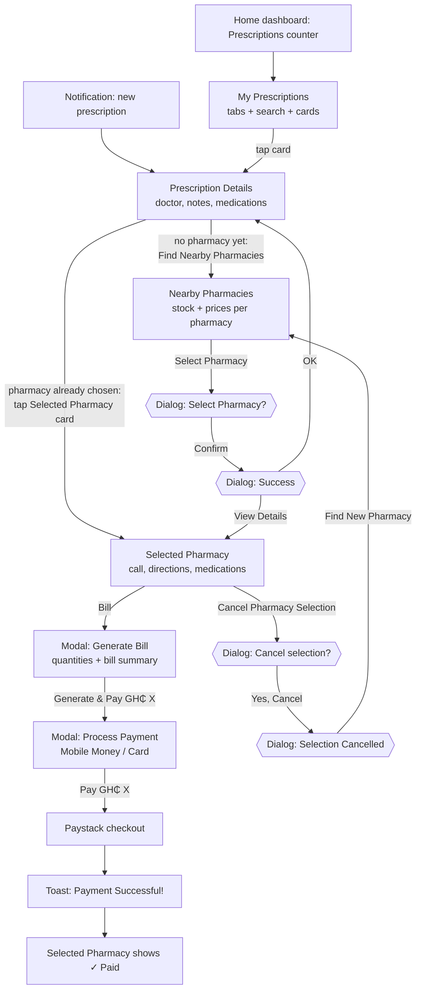

# Prescriptions & Pharmacy — Mockup Spec for the DigCare Website

> **What this is:** a screen-by-screen spec of the **patient** prescription flow in the DigCare mobile app, written so that **Claude Design** can produce accurate phone-screen mockups for the DigCare website (digcaregh.com). It is the companion to `appointment_mockup.md`.
>
> **Source of truth (mobile repo `digitalcare-mobile`):**
>
> | Screen | Code | Styles |
> |---|---|---|
> | My Prescriptions (list) | `app/prescription/patients/MyPrescriptions.tsx` | `styles/prescription/patients/MyPrescriptions.styles.ts` |
> | Prescription Details | `app/prescription/patients/prescription-details/[prescriptionId].tsx` | `…/PrescriptionDetails.styles.ts` |
> | Nearby Pharmacies | `app/prescription/patients/find-pharmacies/[prescriptionId].tsx` | `…/FindPharmacies.styles.ts` |
> | Selected Pharmacy | `app/prescription/patients/selected-pharmacy/[prescriptionId].tsx` | `…/SelectedPharmacy.styles.ts` |
> | Generate Bill (modal) | `app/prescription/patients/GenerateBill.tsx` | `…/GenerateBill.styles.ts` |
> | Process Payment (modal) | `app/payment/ProcessPayment.tsx` | (shared with appointments) |
> | Data shape | `services/prescription/PrescriptionTypes.ts`, `services/prescription/PrescriptionService.tsx` | |
>
> **Important about colours:** these screens set most colours **inline** in the component, and the inline values **override** the style files. For example, the style file gives the active filter chip an emerald look, but the screen paints it solid blue. Every colour in this document is the one that **actually renders** (dark mode). The style-file values that never show are not used.
>
> **Rule for the mockups:** show what the app actually does. Section 11 lists app quirks and what to show instead, so the mockup stays truthful without showing a glitch.

---

## Table of Contents

1. [Brief for Claude Design (copy-paste prompt)](#1-brief-for-claude-design-copy-paste-prompt)
2. [The Flow at a Glance](#2-the-flow-at-a-glance)
3. [Design Tokens (what actually renders)](#3-design-tokens-what-actually-renders)
4. [Shared Screen Patterns](#4-shared-screen-patterns)
5. [Screen-by-Screen Spec](#5-screen-by-screen-spec)
6. [Bill and Payment](#6-bill-and-payment)
7. [System Dialogs (confirmations)](#7-system-dialogs-confirmations)
8. [States: loading, empty, error, disabled](#8-states-loading-empty-error-disabled)
9. [Sample Data for the Mockups](#9-sample-data-for-the-mockups)
10. [Website Storyboards (which frames to make)](#10-website-storyboards-which-frames-to-make)
11. [Accuracy Notes: app quirks and what to show](#11-accuracy-notes-app-quirks-and-what-to-show)
12. [Where the Current Website Copy Differs from the App](#12-where-the-current-website-copy-differs-from-the-app)
13. [Icon Mapping (emoji → Lucide)](#13-icon-mapping-emoji--lucide)
14. [Final Checklist](#14-final-checklist)

---

## 1. Brief for Claude Design (copy-paste prompt)

Paste this into Claude Design together with this file:

```
Create a set of high-fidelity mobile phone mockups (390 × 844, iPhone-style frame,
dark UI) of the DigCare patient "Prescriptions & Pharmacy" flow, for use on the
DigCare marketing website. Follow prescription_mockup.md exactly:

- Use the colours in section 3. The list screen uses a near-black #0F1419
  background with #1A1F29 cards; the detail, pharmacy and bill screens use a
  navy #0A0F1E background with #1A2332 cards. Primary actions are solid blue
  #3B82F6 with white text. Green #10B981 means "in stock / selected / covered /
  paid". Prices sit in mint-on-dark-green boxes (#6EE7B7 on #064E3B).
- Use the system sans-serif font (SF Pro look; Inter is an acceptable stand-in).
  These screens do not use Space Grotesk or Manrope.
- The app uses emoji as icons (📋 💊 🏥 📍 📞 🕐 ⏱️ 💰 💳). Either keep the emoji,
  or swap them for the Lucide icons in section 13. Be consistent across frames.
- Build the 4 frames in section 10 ("Primary storyboard") with the sample data in
  section 9 and the exact copy in section 5.
- Present the phones on the website's navy background (#040415) with a soft
  amber (#F59E0B) or cyan (#00EAFF) glow, each with the caption from section 10.
- Do not invent features that are not in this spec: no refill button, no QR
  code, no map, no distance in km, no "Dispensed" status, no allergy warnings.
```

**Output targets on the site.** The homepage feature card for "Prescriptions & pharmacy" (`src/components/sections/FeaturesSection.tsx`) uses `/assets/Prescription&PharmacyComp1.png`, and `public/assets/` already holds **`Prescription&PharmacyComp1.png`–`Comp4.png`**, so the primary storyboard is four frames. The patient feature page is `/roles/patients/prescriptions` (accent `#10B981`).

---

## 2. The Flow at a Glance

A doctor issues the prescription (outside this flow). The patient then:

1. sees it in **My Prescriptions**,
2. opens **Prescription Details** to read the medications,
3. taps **Find Nearby Pharmacies** to see pharmacies that stock the medications, **with prices**,
4. **selects a pharmacy**, which sends the prescription there,
5. on **Selected Pharmacy**, can call or get directions, and taps **Bill**,
6. adjusts quantities in **Generate Bill** and pays (Mobile Money or card).

### 2.1 Flow diagram



### 2.2 How patients get here

| Entry point | Lands on |
|---|---|
| Patient home dashboard, **Prescriptions** health-summary counter (green, `#10B981`) | My Prescriptions |
| Recent activity item on the dashboard | Prescription Details |
| Push / in-app notification about a prescription | Prescription Details |

The screens sit inside the normal patient tab layout (bottom tab bar visible).

### 2.3 What the app sends at each action

| Action | Request |
|---|---|
| Open Nearby Pharmacies | `GET prescriptions/{id}/find-pharmacies/` (no location is sent; the server decides which pharmacies to return) |
| Select a pharmacy | `POST prescriptions/{id}/select_pharmacy/` with `{ pharmacy_id }` |
| Cancel the selection | `POST prescriptions/{id}/cancel_pharmacy_selection/` |
| Generate & Pay | `POST prescriptions/{id}/generate-bill/` with `{ items: [{ prescription_item_id, pharmacy_inventory_id, quantity }] }` |

### 2.4 How prices are worked out (shown on screen before paying)

```
subtotal          = Σ (unit price × quantity)              (quantity is 1 on the pharmacy list)
platform fee      = subtotal × platform_fee_percentage      (default 15% if the server doesn't send one)
insurance covered = subtotal × coverage_percentage          (only at insurance-accredited pharmacies)
total             = subtotal + platform fee − insurance covered
```

---

## 3. Design Tokens (what actually renders)

These screens **follow the phone's light/dark setting**. Mock them in **dark mode** so they match the appointment mockups. Light values are listed for reference.

### 3.1 Palette A — My Prescriptions (list)

| Token | Dark | Light | Used for |
|---|---|---|---|
| `background` | `#0F1419` | `#F8FAFC` | Screen background |
| `surface` | `#1A1F29` | `#FFFFFF` | Prescription cards |
| `surfaceElevated` | `#232A36` | `#FFFFFF` | Inactive filter chips, empty-state circle |
| `searchBackground` | `#232A36` | `#F1F5F9` | Search field (border `#334155` from the style file) |
| `textPrimary` | `#F1F5F9` | `#0F172A` | Titles, doctor names |
| `textSecondary` | `#94A3B8` | `#475569` | Subtitle, diagnosis line, inactive chip text |
| `textTertiary` | `#64748B` | `#64748B` | Drug list line, card footer, placeholder |
| `primary` | `#3B82F6` | `#3B82F6` | Active chip fill, count badges, retry button, pull-to-refresh |
| `primaryLight` | `#1E3A5F` | `#DBEAFE` | Header count badge, inactive tab count badge, COMPLETED status |
| `border` | `#2D3748` | `#E2E8F0` | Card and chip borders |
| `divider` | `#334155` | `#E2E8F0` | Card divider |

**Status badge colours (list):**

| Status | Background | Text |
|---|---|---|
| `ACTIVE` (or no status) | `#064E3B` | `#10B981` |
| `COMPLETED` | `#1E3A5F` | `#3B82F6` |
| `CANCELLED` | `#7F1D1D` | `#EF4444` |
| Anything else (`ISSUED`, `PENDING`) | `#78350F` | `#F59E0B` (amber) |

### 3.2 Palette B — Details, Nearby Pharmacies, Selected Pharmacy, Generate Bill

| Token | Dark | Light | Used for |
|---|---|---|---|
| `background` | `#0A0F1E` | `#F5F7FA` | Screen / sheet background, cost-summary box, duration pill |
| `card` | `#1A2332` | `#FFFFFF` | Cards |
| `cardSecondary` | `#151D2C` | `#F8F9FB` | Inset panels (doctor row, medication rows, detail icon circles, quantity buttons) |
| `text` | `#E8EAF0` | `#1A1A1A` | Primary text |
| `textSecondary` | `#9CA3BC` | `#6B7280` | Secondary text |
| `textTertiary` | `#6B7280` | `#9CA3AF` | Uppercase labels |
| `primary` | `#3B82F6` | `#3B82F6` | **All primary buttons**, numbered circles, back link, "You Pay" amount, Total Amount |
| `success` | `#10B981` | `#10B981` | In-stock, insured, selected-pharmacy border, paid |
| `successBg` | `#064E3B` | `#D1FAE5` | Green pill/banner backgrounds |
| `priceBackground` / `priceText` | `#064E3B` / `#6EE7B7` | `#ECFDF5` / `#059669` | "Per unit" price box |
| `activeBadge` / `activeBadgeText` | `#064E3B` / `#6EE7B7` | `#D1FAE5` / `#059669` | "ACTIVE" badge on Details |
| `badge` / `badgeText` | `#1E3A5F` / `#60A5FA` | `#DBEAFE` / `#2563EB` | RX ID badge, "Prescription" pills, count circles, doctor/pharmacy icon circles |
| `info` / `infoBg` | `#0EA5E9` / `#164E63` | `#0EA5E9` / `#E0F2FE` | General Instructions box (1px cyan border) |
| `warning` / `warningBg` | `#F59E0B` / `#78350F` | `#F59E0B` / `#FEF3C7` | Status pill on Selected Pharmacy |
| `danger` / `dangerBg` | `#EF4444` / `#7F1D1D` | `#EF4444` / `#FEE2E2` | Important Notice card, cancel button, "- ins." amount, unavailable warning |
| `border` | `#2A3547` | `#E5E7EB` | Card borders, dividers |
| `borderLight` | `#1F2937` | `#F3F4F6` | Inner borders |
| Modal overlay | `rgba(10,15,30,0.95)` | `rgba(0,0,0,0.5)` | Behind Generate Bill |

Primary buttons carry a soft **green-tinted shadow** (`shadowColor #10B981`, ~0.2 opacity, 4–8px blur) even though they're blue. It's barely visible on dark backgrounds, so a soft dark drop shadow is fine.

### 3.3 Palette C — Process Payment (fixed dark theme, ignores light/dark)

| Token | Value | Used for |
|---|---|---|
| background | `#0d1322` | Sheet |
| card / cardSecondary | `#191f2f` / `#242a3a` | Sections |
| text / textSecondary / textTertiary | `#dde2f8` / `#bbcabf` / `#86948a` | Text |
| primary | `#4edea3` (bright emerald), text on it `#003824` | Pay button, selected method |
| successBg | `#00422b` | Success areas |
| danger / dangerBg | `#ffb4ab` / `#93000a` | Errors |
| border | `#3c4a42` | Borders |
| badge / badgeText | `#571bc1` / `#c4abff` | Violet accents |
| input background | `#151b2b` | Email field |

### 3.4 Typography

No custom font is set on any of these screens, so they render in the **system font** (SF Pro on iOS, Roboto on Android). On the website, **Inter** (already the site's body font) is the closest match.

| Role | Size | Weight | Notes |
|---|---|---|---|
| List screen title "Prescriptions" | 32 | 700 | letter-spacing −0.5 |
| Other screen titles ("📋 Prescription Details") | 28 | 800 | letter-spacing −0.5 |
| Screen subtitle | 14–15 | 500 | secondary colour |
| "← Back" link | arrow 24/700, text 16/600 | | blue `#3B82F6` |
| Card title (doctor on list, pharmacy name) | 18 | 700–800 | |
| Section title ("Medications") | 20 | 800 | 17–18 inside cards and modals |
| Drug name (details card) | 17 | 700 | |
| Drug name (rows) | 15 | 700 | |
| Uppercase labels ("PRESCRIBED BY", "DOSAGE") | 10–11 | 600–700 | UPPERCASE, letter-spacing 0.5 |
| Body / meta text | 13–14 | 500 | |
| Status badge (list) | 13 | 700 | UPPERCASE |
| Status badge (details) | 12 | 700 | UPPERCASE |
| Prices in boxes | 16 | 800 | |
| "You Pay" amount | 20 | 900 | blue |
| Bill "Total Amount" value | 22 | 800 | blue |
| Primary button text | 15–16 | 700–800 | white |
| Modal title "💰 Generate Bill" | 24 | 800 | |

### 3.5 Shape and spacing

| Element | Radius | Padding |
|---|---|---|
| Screen side gutters | — | 20 |
| Main cards | 16 | 16–20 |
| Inset rows, banners, cost box, buttons | 12 | 12–16 |
| Small boxes (price box, duration badge) | 10 | 8–12 |
| Small pills (stock, insurance, duration, qty) | 8 | 4–8 h |
| Status / ID / "Prescription" pills | 12–16 | 6 v / 10–14 h |
| Filter chips | pill (9999) | 8 v / 16 h |
| Circles | 24 (count badge), 32–36 (detail icons, numbers, qty buttons), 40 (rank, doctor icon), 48 (pharmacy icon), 80 (error), 120 (empty) | |
| Bottom-sheet modal | 24 top corners | 20 |
| Vertical gap between blocks | 16 | |

---

## 4. Shared Screen Patterns

### 4.1 Detail-style header (Details, Nearby Pharmacies, Selected Pharmacy)

```
(60px top inset)
← Back                                   ← blue link, left-aligned
📋 Prescription Details                   ← 28/800
Review your medication information        ← 14/500 secondary
```

There is **no top bar** and **no step indicator**. The header scrolls with the content, and the screen sits above the patient bottom tab bar.

### 4.2 Labelled info row

A 32–36px round icon well (`cardSecondary`) holding an emoji, then an UPPERCASE 10–11px label over a 14–15px value. Used for DOSAGE, FREQUENCY, LOCATION, PHONE NUMBER.

### 4.3 Pills

| Pill | Look | Example text |
|---|---|---|
| "Prescription" | `#1E3A5F` bg, `#60A5FA` text, 12/700 | Prescription |
| In stock | `#064E3B` bg, 6px green dot, green 11/700 text | ● In Stock |
| Stock count (pharmacy list) | `#0A0F1E` bg, "STOCK" 11/600 grey + number 13/800 | STOCK 120 |
| Stock count (bill) | `#064E3B` bg, green 11/600 | 120 in stock |
| Insurance | `#064E3B` bg, green 10/700, radius 8 | INSURED NHIS · 70% covered |
| Duration (selected pharmacy) | `#0A0F1E` bg, grey 11/600 | Duration: 7 days |

---

## 5. Screen-by-Screen Spec

Copy in quotes is the exact text. `{…}` marks live data.

---

### Screen 1 — My Prescriptions (list)

Palette A. Top padding 20 + header padding 24.

```
┌──────────────────────────────────────────┐
│ Prescriptions                      ( 3 )  │  32/700 title · blue count pill
│ 3 prescriptions                           │
│                                           │
│ (All 3) (Active) (Completed 1) (Cancelled)│  chips, horizontal scroll
│                                           │
│ ┌ 🔍 Search prescriptions...          ✕ ┐ │
│                                           │
│ ┌──────────────────────────────────────┐ │
│ │ Dr. Kwame Mensah          ┌────────┐ │ │
│ │ Acute bacterial sinusitis │ ISSUED │ │ │  amber badge
│ │ Amoxicillin, Paracetamol… └────────┘ │ │
│ │ ──────────────────────────────────── │ │
│ │ 📅 Oct 12, 2026                       │ │
│ └──────────────────────────────────────┘ │
│ ┌──────────────────────────────────────┐ │
│ │ Dr. Abena Asante        [COMPLETED]  │ │  blue badge
│ │ Seasonal allergic rhinitis           │ │
│ │ Cetirizine                           │ │
│ │ ──────────────────────────────────── │ │
│ │ 📅 Sep 3, 2026                        │ │
│ └──────────────────────────────────────┘ │
└──────────────────────────────────────────┘
```

**Header**
- Title **"Prescriptions"** (32/700).
- Subtitle **"{n} prescription(s)"**, with **" (filtered)"** appended when a tab other than All is active.
- Right: count pill, `#1E3A5F` bg, blue `#3B82F6` number 14/700, radius 20, 1px `#334155` border.

**Filter chips** (horizontal scroll, 12px gap): **All · Active · Completed · Cancelled**
- Inactive: `#232A36` fill, `#2D3748` border, text `#94A3B8` 14/600.
- Active: **solid blue `#3B82F6`** fill and border, **white** text.
- Count bubble (20px pill) after the label, **only when the count is above 0**: inactive `#1E3A5F` with blue number; active white-20% with white number.

**Search field:** `#232A36` fill, 1px `#334155` border, radius 12, 🔍 at 60% opacity, placeholder **"Search prescriptions..."**, a **✕** clear button appears once text is typed.

**Prescription card** (radius 16, padding 20, `#1A1F29`, 1px `#2D3748`, soft shadow, 16px between cards). Tapping opens Details.

| Part | Content | Style |
|---|---|---|
| Line 1 | Doctor's full name, or "Unknown Doctor" | 18/700, primary text, 1 line |
| Line 2 | **Diagnosis**, or the drug list if there's no diagnosis | 14/500, secondary, 1 line, ellipsis |
| Line 3 | Drug list (only when line 2 is the diagnosis), e.g. "Amoxicillin, Paracetamol" | 13/400, tertiary, 1 line, ellipsis |
| Status badge (top right) | Status text, UPPERCASE | radius 12, min-width 90, 8 v / 14 h padding, colours in 3.1 |
| Divider | 1px `#334155`, 16px above and below | |
| Footer | "📅 {Mon d, yyyy}" (date issued); "🏥 {hospital}" on the right if available | 13/500, tertiary |

**List behaviour:** pull to refresh (blue spinner); loads more on scroll with "Loading more prescriptions..." and ends with "No more prescriptions to show".

---

### Screen 2 — Prescription Details

Palette B. Scrolling page, 16px between blocks.

```
← Back
📋 Prescription Details
Review your medication information

┌──────────────────────────────────────────┐
│ PRESCRIPTION ID                ● ACTIVE  │
│ [ RX-3F2A9C ]                             │
│ ──────────────────────────────────────── │
│ ┌──────────────────────────────────────┐ │
│ │ (👨‍⚕️) PRESCRIBED BY                   │ │
│ │       Dr. Kwame Mensah               │ │
│ └──────────────────────────────────────┘ │
│ ──────────────────────────────────────── │
│ CLINICAL NOTES                            │
│ Symptoms for 10 days, facial pressure…    │
│ ──────────────────────────────────────── │
│ ┌ (ℹ️) General Instructions ───────────┐ │  cyan box
│ │ Finish the full course of antibiotics│ │
│ │ even if you feel better.             │ │
│ └──────────────────────────────────────┘ │
└──────────────────────────────────────────┘

💊 Medications                         ( 2 )

┌──────────────────────────────────────────┐
│ (1) Amoxicillin                           │
│ ──────────────────────────────────────── │
│ (💊) DOSAGE         (🕐) FREQUENCY         │
│      500 mg              Three times daily│
│ ┌ ⏱️ Duration: 7 days ─────────────────┐ │
│ ┌ 📋 Take after meals with water ──────┐ │
└──────────────────────────────────────────┘
┌──────────────────────────────────────────┐
│ (2) Paracetamol  …                        │
└──────────────────────────────────────────┘

[        🏥 Find Nearby Pharmacies         ]   blue, 16px tall padding
[        ← Back to Prescriptions           ]   outlined
```

**Header** (section 4.1): "📋 Prescription Details" / "Review your medication information".

**Summary card** (radius 16, padding 20, `#1A2332`, 1px `#2A3547`, 16px internal gap):
- **"PRESCRIPTION ID"** label (11/600 uppercase, tertiary) over an ID pill (`#1E3A5F` bg, `#60A5FA` text 16/800): **"RX-{id}"**.
- **Status badge** top right: `#064E3B` bg, 6px green dot, **"ACTIVE"** (12/700 `#6EE7B7`). This badge always says Active (see section 11).
- **Prescribed by** (if a doctor is attached): inset row (`#151D2C`, radius 12, padding 12): 40px `#1E3A5F` circle with 👨‍⚕️, label **"PRESCRIBED BY"**, name 15/700.
- **"CLINICAL NOTES"** (if notes exist): label + notes text 14/500 secondary.
- **General Instructions** (if present): box with `#164E63` fill, **1px `#0EA5E9` border**, radius 12, padding 14. Header: 24px circle with ℹ️ + **"General Instructions"** (13/700 cyan). Body 14/500 primary text.

**Medications header:** "💊 **Medications**" (20/800), and a 32px `#1E3A5F` circle with the count (14/800 `#60A5FA`) on the right.

**Medication card** (one per drug; radius 16, padding 16, 12 gap):

| Part | Spec |
|---|---|
| Number | 36px **blue** circle, white number 16/800 |
| Drug name | 17/700 (or "Unnamed Drug") |
| Divider | 1px `#1F2937` |
| Two columns | **DOSAGE** (💊 in 32px `#151D2C` circle) and **FREQUENCY** (🕐). Label 10/600 uppercase tertiary, value 14/700 |
| Duration bar | `#151D2C`, 1px `#1F2937`, radius 10, padding 12: "⏱️ **Duration:** {7} {days}" (label 13/600 tertiary, value 14/800) |
| Item instructions (optional) | same inset style: "📋 {Take after meals…}" 13/500 secondary |

**Actions (bottom):**
- **No pharmacy chosen yet:** blue button **"🏥 Find Nearby Pharmacies"** (radius 12, 16 v padding, white 16/700).
- **Pharmacy already chosen:** instead of the button, a tappable **Selected Pharmacy card**: **2px green `#10B981` border**, radius 16, padding 16, soft green glow. 48px `#064E3B` circle with 🏥, **"SELECTED PHARMACY"** (10/700 green), name (17/800), "📍 {address}" (13/500, 1 line), and a green **→** on the right. Tapping it opens Screen 4.
- Always: outlined **"← Back to Prescriptions"** (1.5px `#2A3547` border, `#1A2332` fill, 15/600).

---

### Screen 3 — Nearby Pharmacies

Palette B. A list of pharmacy cards, 16px apart, 20px gutters.

```
← Back
🏥 Nearby Pharmacies
2 pharmacies with your medications in stock
[ Prescription ]

┌──────────────────────────────────────────┐
│ (1)  Osu Community Pharmacy               │
│      [INSURED NHIS · 70% covered]         │
│      📍 14 Cantonments Road, Osu, Accra   │
│      📞 +233 30 000 0000                  │
│ ──────────────────────────────────────── │
│ 💊 Available Medications      ● In Stock  │
│ ┌──────────────────────────┬───────────┐ │
│ │ Amoxicillin 500mg        │  PER UNIT │ │
│ │ [STOCK 240]              │  GH₵12.50 │ │
│ └──────────────────────────┴───────────┘ │
│ ┌──────────────────────────┬───────────┐ │
│ │ Paracetamol 500mg        │  PER UNIT │ │
│ │ [STOCK 600]              │  GH₵4.50  │ │
│ └──────────────────────────┴───────────┘ │
│ ┌ Cost Summary        2 items · qty 1 each│
│ │ Estimated Cost   ~~GH₵17.00~~  GH₵5.10 │ │
│ │ - GH₵11.90 ins.         + GH₵2.55 fee │ │
│ │ ─────────────────────────────────────  │ │
│ │ You Pay                      GH₵7.65   │ │  blue 20/900
│ └────────────────────────────────────────┘ │
│ [            ✓ Select Pharmacy          ] │  blue
└──────────────────────────────────────────┘
```

**Header:** "← Back", **"🏥 Nearby Pharmacies"**, subtitle **"{n} pharmacies with your medications in stock"**, then a small **"Prescription"** pill (`#1E3A5F` / `#60A5FA`).

**Pharmacy card** (radius 16, padding 20, `#1A2332`, 1px `#2A3547`, 16px gap):

1. **Header row**
   - **Rank circle:** 40px **blue**, white number 18/800 (1, 2, 3… in the order the server returns).
   - **Name** 18/700.
   - **Insurance pill** (only at insurance-accredited pharmacies): `#064E3B`, green 10/700, **"INSURED {provider} · {70}% covered"**.
   - "📍 {address}" and "📞 {phone}" lines (13/500 secondary).
2. **Divider.**
3. **"💊 Available Medications"** (16/700) with an **"● In Stock"** pill on the right.
4. **Medication rows** (`#151D2C`, 1px `#1F2937`, radius 12, padding 12):
   - Left: drug name (15/700) and a **STOCK {qty}** pill.
   - Right: **price box** (`#064E3B`, radius 10, min-width 90, right-aligned): **"PER UNIT"** (10/600) over **"GH₵{12.50}"** (16/800), both mint `#6EE7B7`.
5. **Cost Summary box** (`#0A0F1E` fill, 1px border, radius 12, padding 16):
   - Header: **"Cost Summary"** (16/700, grey) and **"{n} items · qty 1 each"** (13/500).
   - **Not insured:** one row, **"Total Estimated Cost"** → **"GH₵{subtotal + fee}"** (16/700).
   - **Insured with coverage:**
     - Row 1: **"Estimated Cost"**, then the subtotal **struck through** (grey) and the after-coverage amount (green).
     - Row 2: **"- GH₵{x} ins."** in **red** and **"+ GH₵{y} fee"** in **green**.
     - Row 3 (top border): **"You Pay"** (16/800) and the final amount in **blue 20/900**.
6. **"✓ Select Pharmacy"** button: full width, blue, radius 12, 14 v padding, white 15/700. While saving: white spinner + **"Selecting..."** at 60% opacity.

Tapping Select opens a confirmation dialog (section 7).

---

### Screen 4 — Selected Pharmacy

Palette B. Scrolling page.

```
← Back
Selected Pharmacy
Your prescription is ready for pickup

┌ (✓) Pharmacy Selected Successfully ─────┐   green banner
│     Your prescription has been sent to   │
│     this pharmacy                        │
└──────────────────────────────────────────┘
┌──────────────────────────────────────────┐
│ [ Prescription ]               ● Issued   │   amber pill
└──────────────────────────────────────────┘
┌──────────────────────────────────────────┐
│ (🏥) SELECTED PHARMACY                    │
│      Osu Community Pharmacy               │
│ ──────────────────────────────────────── │
│ (📍) LOCATION                             │
│      14 Cantonments Road, Osu, Accra      │
│ (📞) PHONE NUMBER                         │
│      +233 30 000 0000                     │
│ [   📞 Call   ]   [  🗺️ Directions  ]     │   two blue buttons
└──────────────────────────────────────────┘
┌──────────────────────────────────────────┐
│ 💊 Prescribed Medications      [💰 Bill]  │   or [✓ Paid]
│ ┌ 💊 Amoxicillin                        ┐ │
│ │    500 mg • Three times daily         │ │
│ │    [Duration: 7 days]                 │ │
│ ┌ 💊 Paracetamol                        ┐ │
│ │    1 g • Every 8 hours                │ │
│ │    [Duration: 5 days]                 │ │
└──────────────────────────────────────────┘
┌ (⚠️) Important Notice ───────────────────┐   red card
│     If you cancel this selection, you'll  │
│     need to choose another pharmacy and   │
│     your prescription may be delayed.     │
└──────────────────────────────────────────┘
[      ✕ Cancel Pharmacy Selection        ]   red outline
```

**Header:** "← Back", **"Selected Pharmacy"**, **"Your prescription is ready for pickup"**.

**Success banner** (`#064E3B`, radius 12, padding 16): 36px **green** circle with a white ✓, **"Pharmacy Selected Successfully"** (15/800 green) and **"Your prescription has been sent to this pharmacy"** (13/500 secondary).

**Prescription strip** (card, radius 12, padding 16): **"Prescription"** pill on the left; on the right a **status pill**: `#78350F` bg, 6px amber dot, amber 12/700 text, Title-case (e.g. "Issued").

**Pharmacy card** (radius 16, padding 20):
- 48px `#1E3A5F` circle with 🏥, **"SELECTED PHARMACY"** (11/600 tertiary), name (18/800).
- Divider.
- **LOCATION** row (📍) and **PHONE NUMBER** row (📞), 36px `#151D2C` icon circles, values 15/600.
- Two equal **blue** buttons side by side (10px gap, radius 12): **"📞 Call"** (opens the phone dialler) and **"🗺️ Directions"** (opens Google Maps at the pharmacy).

**Medications card** (radius 16, padding 20):
- **"💊 Prescribed Medications"** (17/800).
- Right side: small **blue "💰 Bill"** button (radius 10, 8 v / 12 h, white 13/700), **or**, once paid, a **"✓ Paid"** pill (`#064E3B`, green 13/600).
- Rows (`#151D2C`, radius 12, padding 12): 💊, drug name (15/700), **"{dosage} • {frequency}"** (13/500), and a **"Duration: {n} {unit}"** pill.

**Important Notice card:** `#7F1D1D` fill, **1px `#EF4444` border**, radius 12. 36px translucent-red circle with ⚠️, **"Important Notice"** (15/700 red), body text (13/500 secondary): *"If you cancel this selection, you'll need to choose another pharmacy and your prescription may be delayed."*

**Cancel button:** `#1A2332` fill, **2px red border**, radius 12, 16 v padding: **"✕ Cancel Pharmacy Selection"** (16/700 red). Once paid it fades to 50% and reads **"✕ Cannot Cancel - Bill Paid"** in grey. While cancelling: red spinner + **"Cancelling..."**.

---

## 6. Bill and Payment

### 6.1 Modal — "💰 Generate Bill"

Opens from the **💰 Bill** button. A bottom sheet covering **90% of the screen**, 24px top corners, `#0A0F1E`, over a near-opaque overlay `rgba(10,15,30,0.95)`.

```
┌──────────────────────────────────────────┐
│ 💰 Generate Bill                     (✕)  │  24/800
│ [ Prescription Bill ]                     │
├──────────────────────────────────────────┤
│ ┌──────────────────────────────────────┐ │
│ │ (🏥) PHARMACY                         │ │
│ │      Osu Community Pharmacy           │ │
│ │      📍 14 Cantonments Road, Osu      │ │
│ └──────────────────────────────────────┘ │
│ 💊 Medications                       (2)  │
│ ┌──────────────────────────────────────┐ │
│ │ (💊) Amoxicillin            GH₵262.50 │ │
│ │      [240 in stock]     @ GH₵12.50   │ │
│ │ ──────────────────────────────────── │ │
│ │ Quantity              (−) [ 21 ] (+)  │ │
│ └──────────────────────────────────────┘ │
│ ┌──────────────────────────────────────┐ │
│ │ (💊) Paracetamol             GH₵67.50 │ │
│ │      [600 in stock]      @ GH₵4.50   │ │
│ │ Quantity              (−) [ 15 ] (+)  │ │
│ └──────────────────────────────────────┘ │
│ ┌ 📊 Bill Summary ─────────────────────┐ │
│ │ Subtotal                 GH₵ 330.00  │ │
│ │ Platform Fee (15%)        GH₵ 49.50  │ │
│ │ Insurance Covered (70%) - GH₵ 231.00 │ │  green
│ │ ──────────────────────────────────── │ │
│ │ Total Amount             GH₵ 148.50  │ │  blue 22/800
│ └──────────────────────────────────────┘ │
├──────────────────────────────────────────┤
│ [ Cancel ]  [ 💳 Generate & Pay GH₵ 148.50 ]│
└──────────────────────────────────────────┘
```

| Part | Spec |
|---|---|
| Header | **"💰 Generate Bill"** (24/800), a **"Prescription Bill"** pill below, a 40px round **✕** close button (`#151D2C`) on the right; 1px bottom border |
| Paid banner (only if already paid) | Green: ✓ **"Payment Complete"** / "This prescription has been paid for" |
| Pharmacy section | Card: 40px `#064E3B` circle with 🏥, **"PHARMACY"** label, name (16/800), "📍 {address}" |
| Medications header | "💊 **Medications**" (18/800) + 28px count circle |
| Bill item card | 36px `#151D2C` circle with 💊; name (15/700); **"{stock} in stock"** green pill. Right-aligned: line total **"GH₵{x}"** (17/800) over **"@ GH₵{unit}"** (11/500). Divider. **"Quantity"** label with a stepper: 36px round **−** and **+** buttons (`#151D2C`, 1px border) around a value box (min-width 50, 16/800). **−** is faded at 1; **+** is faded at the stock limit |
| Unavailable item | Red box under the item: **"⚠️ Not available in pharmacy inventory"**. The pay button is disabled while any item shows this |
| Bill Summary | Card titled "📊 **Bill Summary**", inner panel `#151D2C`: **Subtotal**, **Platform Fee ({15}%)**, **Insurance Covered ({70}%)** in green (only when insured), divider, **Total Amount** (16/800) with the value in **blue 22/800** |
| Footer | **Cancel** (outlined, flex 1) and **"💳 Generate & Pay GH₵ {total}"** (blue, flex 2, white 15/800). While working: spinner + **"Processing..."** |

Quantities start at the prescribed quantity (or 1) and can't go above the pharmacy's stock.

### 6.2 Modal — "💳 Process Payment"

This is the **same payment sheet used for appointments** (Palette C, bright emerald `#4edea3`).

- Title **"💳 Process Payment"**, subtitle **"Bill: {bill number}"**, ✕ close.
- **PAYMENT SUMMARY:** Service Amount, Platform Fee, "🏥 Insurance Covered" (if any), divider, **Total Amount**.
- **Payment Method:** **📱 Mobile Money** (selected by default) / **💳 Card Payment**.
- **Email Address \*** field, placeholder "your.email@example.com".
- Footer: **Cancel** and **"💳 Pay GH₵ {total}"**.
- Then Paystack checkout in the app (**"Complete Payment"**, amount, "Loading payment page..."), then an emerald toast **"Payment Successful!"** / "Your payment of GH₵ {total} was processed successfully".

After payment, Selected Pharmacy shows **✓ Paid** and the cancel button is locked.

---

## 7. System Dialogs (confirmations)

These are **native OS alert dialogs** (iOS/Android style), not custom UI. If a frame needs one, draw a standard iOS alert over the dimmed screen.

| When | Title | Message | Buttons |
|---|---|---|---|
| Tap Select Pharmacy | **Select Pharmacy** | "Do you want to select {pharmacy} for this prescription?" | Cancel · **Confirm** |
| Selection saved | **Success** | "{pharmacy} has been selected for your prescription." | **View Details** · OK |
| Selection failed | Error | server message or "Failed to select pharmacy. Please try again." | OK |
| Tap Cancel Pharmacy Selection | **Cancel Pharmacy Selection** | "Are you sure you want to cancel this pharmacy selection? You'll need to select a pharmacy again." | No, Keep Selection · **Yes, Cancel** (destructive red) |
| Cancel succeeded | **Selection Cancelled** | "Pharmacy selection has been cancelled successfully." | **Find New Pharmacy** · OK |
| Generate & Pay when already paid | Already Paid | "This prescription has already been paid for." | OK |
| Item not stocked | Unavailable Items | "Some medications are not available in the selected pharmacy inventory." | OK |
| Bill exists already | Bill Already Exists | server message | **View Bill** · Cancel |

---

## 8. States: loading, empty, error, disabled

### 8.1 Loading

| Screen | What shows |
|---|---|
| My Prescriptions (first load) | **Skeleton list**: 6 grey placeholder cards |
| Prescription Details | Centred blue spinner, **"Loading prescription details..."** / "Please wait while we fetch your information" |
| Nearby Pharmacies | Centred blue spinner, **"Finding pharmacies near you..."** / "Checking availability for your prescription" |
| Selected Pharmacy | Centred blue spinner, **"Loading pharmacy details..."** / "Please wait while we fetch your information" |
| Generate Bill (stock re-check) | Blue spinner card, **"Checking Availability..."** / "Re-checking medication stock in the selected pharmacy" |

### 8.2 Empty

| Screen | Look | Copy |
|---|---|---|
| My Prescriptions | 120px `#232A36` circle with 📋, title 22/700, text 15/500 | **"No prescriptions"** / "Your prescriptions will appear here". On a tab: "No active prescriptions" / "Active prescriptions will appear here" (same for completed, cancelled) |
| Details, no medications | Dashed-border card, 💊 | **"No Medications"** / "No medications found for this prescription" |
| Nearby Pharmacies | Dashed-border card, 🏥 64px | **"No Pharmacies Found"** / "We couldn't find any pharmacies with your prescription medications in stock at the moment." + blue **"← Go Back"** |
| Selected Pharmacy, none chosen | Dashed-border card, 🏥 | **"No Pharmacy Selected"** / "You haven't selected a pharmacy for this prescription yet. Find one near you now." + blue **"🔍 Find Pharmacies"** |
| Generate Bill, nothing billable | Dashed card, 💊 | **"No Medications"** / "No medications available for billing" |

### 8.3 Error (My Prescriptions)

80px `#7F1D1D` circle (1px red border) with ⚠️, **"Something went wrong"** (20/700), the error text, and a blue **"Try Again"** button.

### 8.4 Disabled

- Select Pharmacy while saving: 60% opacity.
- Generate & Pay when an item is unavailable or there are no items: 60% opacity.
- Quantity − at 1, + at stock limit: 50% opacity.
- Cancel Pharmacy Selection after payment: 50% opacity, grey "Cannot Cancel - Bill Paid".

---

## 9. Sample Data for the Mockups

All people and pharmacy names below are **fictional placeholders**. They reuse the doctors from `appointment_mockup.md` so the two flows tell one story. Replace them only with names DigCare has permission to show.

**Today in the mockups:** Wednesday, 14 October 2026.

### 9.1 Prescriptions (list)

| Doctor | Diagnosis | Drugs | Status | Date |
|---|---|---|---|---|
| Dr. Kwame Mensah | Acute bacterial sinusitis | Amoxicillin, Paracetamol | ISSUED (amber) | Oct 12, 2026 |
| Dr. Abena Asante | Seasonal allergic rhinitis | Cetirizine | COMPLETED (blue) | Sep 3, 2026 |
| Dr. Yaw Boateng | — | Omeprazole | CANCELLED (red) | Aug 20, 2026 |

Header: "Prescriptions", "3 prescriptions", count pill **3**. Chips: **All 3** (active), Active (no bubble), Completed 1, Cancelled 1.

### 9.2 The featured prescription (Dr. Kwame Mensah)

- ID pill: **RX-3F2A9C** (see section 11 #3)
- Clinical notes: *"Symptoms for 10 days with facial pressure and congestion. No known drug allergies."*
- General instructions: *"Finish the full course of antibiotics even if you feel better. Drink plenty of water and rest."*

| # | Drug | Dosage | Frequency | Duration | Item instructions |
|---|---|---|---|---|---|
| 1 | Amoxicillin | 500 mg | Three times daily | 7 days | Take after meals with water |
| 2 | Paracetamol | 1 g | Every 8 hours | 5 days | Only when needed for pain or fever |

### 9.3 Pharmacies

| # | Name | Insurance | Address | Phone | Amoxicillin (unit / stock) | Paracetamol (unit / stock) |
|---|---|---|---|---|---|---|
| 1 | Osu Community Pharmacy | NHIS · 70% covered | 14 Cantonments Road, Osu, Accra | +233 30 000 0000 | GH₵12.50 / 240 | GH₵4.50 / 600 |
| 2 | Labone Care Pharmacy | — | 7 Labone Crescent, Accra | +233 30 000 0001 | GH₵13.00 / 90 | GH₵3.50 / 300 |

Use placeholder phone numbers (as above) rather than real ones.

**Cost summary at quantity 1 each (as the pharmacy list shows):**

| Pharmacy | Subtotal | Fee 15% | Insurance | Shown as |
|---|---|---|---|---|
| Osu Community (insured 70%) | GH₵17.00 | GH₵2.55 | − GH₵11.90 | Estimated Cost ~~GH₵17.00~~ GH₵5.10 · "- GH₵11.90 ins." · "+ GH₵2.55 fee" · **You Pay GH₵7.65** |
| Labone Care (not insured) | GH₵16.50 | GH₵2.48 | — | **Total Estimated Cost GH₵18.98** |

### 9.4 Bill (Generate Bill modal, Osu Community Pharmacy)

| Drug | Qty | Unit | Line total |
|---|---|---|---|
| Amoxicillin | 21 | GH₵12.50 | GH₵262.50 |
| Paracetamol | 15 | GH₵4.50 | GH₵67.50 |

Subtotal **GH₵ 330.00** · Platform Fee (15%) **GH₵ 49.50** · Insurance Covered (70%) **− GH₵ 231.00** · Total **GH₵ 148.50** · Button **"💳 Generate & Pay GH₵ 148.50"**.

Bill number for the payment sheet: **BILL-2026-00562**.

---

## 10. Website Storyboards (which frames to make)

### 10.1 Primary storyboard (4 frames → `Prescription&PharmacyComp1–4.png`)

| # | Frame | What's on screen | Caption for the website |
|---|---|---|---|
| 1 | **My Prescriptions** | Header with 3, All chip active, three cards (ISSUED amber, COMPLETED blue, CANCELLED red) | **Every prescription in one place.** See who prescribed it, what for, and where it stands. |
| 2 | **Prescription Details** | ID pill, Prescribed by Dr. Kwame Mensah, General Instructions box, Amoxicillin card fully visible, Paracetamol card starting below; scroll so the **Find Nearby Pharmacies** button is just in view | **No handwriting to decode.** Dosage, frequency, duration and instructions for every medication. |
| 3 | **Nearby Pharmacies** | Card 1 (Osu Community, NHIS 70%) fully visible with both medications, price boxes, cost summary with **You Pay GH₵7.65** and Select Pharmacy | **Compare stock and prices before you go.** See which pharmacies have your medication, and what your insurance covers. |
| 4 | **Selected Pharmacy** | Success banner, pharmacy card with Call / Directions, Prescribed Medications with **💰 Bill** button | **Send it to the pharmacy and you're set.** Call or get directions straight from the app. |

### 10.2 Optional extra frames

| Frame | Use it for | Notes |
|---|---|---|
| **Generate Bill** modal (9.4) | Insurance & payments sections; a 5th prescription frame | Shows quantity steppers and insurance coverage |
| **Process Payment**, Mobile Money selected | "Pay with Mobile Money" messaging | Same sheet as appointments |
| **Selected Pharmacy, paid** | "Paid" state | ✓ Paid pill, greyed "Cannot Cancel - Bill Paid" |
| **Details with Selected Pharmacy card** | Showing the green linked-pharmacy card | Replaces the blue button |
| **Select Pharmacy dialog** over Screen 3 | Explaining the confirmation step | Native iOS alert |

### 10.3 Presentation on the website

- **Frame size:** 390 × 844, rounded device frame. Show the patient bottom tab bar at the bottom of frames 1–4 (the app shows it on these screens) or crop just above it.
- **Background around the phones:** the site's navy `#040415`. The homepage card for this feature uses **amber `#F59E0B`** as its accent with a "Ready for pickup" chip, so an amber glow ties the phones to that card. On `/roles/patients/prescriptions` the accent is emerald `#10B981`.
- **Inside the phone:** keep the app's own blue buttons and navy surfaces. Don't recolour them to amber or cyan.
- **Layout ideas:**
  - Homepage: 2 overlapping phones (frames 1 and 3) with frames 2 and 4 in a carousel.
  - Feature page: a 4-step row using the site's `StepFlow` component, one phone per step, captions from 10.1.
- **Alt text:** one per frame, e.g. "Nearby pharmacies: Osu Community Pharmacy has Amoxicillin and Paracetamol in stock; with NHIS covering 70%, the patient pays GH₵7.65".

---

## 11. Accuracy Notes: app quirks and what to show

| # | What the app does | What to show in the mockup |
|---|---|---|
| 1 | The app's prescription statuses are **PENDING, ISSUED, COMPLETED, CANCELLED**, but the list's tabs are **All / Active / Completed / Cancelled**. No prescription has the status "Active", so the **Active tab is always empty** and issued prescriptions only appear under All, with an **amber** badge. | Show the **All** tab selected. Show issued prescriptions with the **amber "ISSUED"** badge. Don't show a populated Active tab. |
| 2 | The Details screen's status badge is **hard-coded to "ACTIVE"** (green), whatever the real status is. | Show **ACTIVE** on Details (that's what patients see), or avoid putting a completed/cancelled prescription on the Details frame. |
| 3 | The ID pill shows **"RX-" + the full ID**. IDs are UUIDs, so in reality it reads like "RX-3f2a9c1e-7b4d-…" (long, may wrap). | Show a short **"RX-3F2A9C"** for readability, or make the pill truncate cleanly. |
| 4 | The list card shows the **diagnosis**, but the Details screen **doesn't**. | Keep the diagnosis on the list only. |
| 5 | List search only matches the **prescription ID, notes and patient name**, not the doctor or drug name. | Don't show a search for a drug or doctor name returning results. Leave the search field empty. |
| 6 | The list card draws **two divider lines** 16px apart (a divider plus the footer's top border). | Show **one** divider. |
| 7 | "Nearby" pharmacies: the app sends **no location**, shows **no distance**, and numbers cards 1, 2, 3 in the server's order. | Don't add "1.2 km" or a map. The rank numbers are fine. |
| 8 | The pharmacy list's cost summary assumes **quantity 1 of each drug** ("qty 1 each"); the real quantities are set later in Generate Bill. | Show "qty 1 each" amounts on Screen 3 and the real quantities only in the bill modal. |
| 9 | Selected Pharmacy says **"Your prescription is ready for pickup"** right after selection, **before** payment or any pharmacy confirmation. | Keep the app's copy on the frame, but avoid repeating "ready for pickup" as a website promise (see section 12). |
| 10 | The status pill on Selected Pharmacy is **always amber**, whatever the status. | Show it amber with "Issued". |
| 11 | "Find Nearby Pharmacies" appears on **every** prescription without a pharmacy, including completed and cancelled ones. | Only show it on an issued prescription. |
| 12 | The app **follows the phone's light/dark mode**, except the payment sheet, which is always dark. | Mock everything **dark**. |
| 13 | Icons are **emoji** rendered by the OS. | Keep the emoji (Apple style), or swap to Lucide using section 13 consistently. |
| 14 | When a tab's list is empty, the "All" empty title reads "No  prescriptions" (double space). | Write "No prescriptions". |

---

## 12. Where the Current Website Copy Differs from the App

The website describes prescriptions in two places: the homepage feature card (`FeaturesSection.tsx`, key `prescriptions`) and `/roles/patients/prescriptions` (`src/app/roles/patients/_data/features.tsx`). Several claims don't match this patient flow:

| Website says | The app actually | Suggestion |
|---|---|---|
| "Request refills in a tap" / "Refill requests… routed to the prescribing doctor" | **No refill button** on any patient prescription screen | Remove, or mark as coming soon |
| "Allergy & interaction flags" | Nothing on these screens shows allergy or interaction checks (allergies exist on the patient record, but aren't shown here) | Remove unless the doctor-side issue flow does this |
| "Show your Health Card QR at a partner pharmacy" | The patient **chooses a pharmacy in the app** and the prescription is **sent** there. There's no QR step in this flow | "Pick a pharmacy that has your medication in stock, and your prescription is sent there" |
| "Status tracking: Issued → Dispensed" / "Dispensed vs. pending" | Statuses are **Pending, Issued, Completed, Cancelled**. There's no "Dispensed" label | Use "Issued → Completed", or keep "dispensed" only as plain language |
| "Your pharmacy sees them immediately" | The pharmacy gets the prescription **once the patient selects it** | "Send it to the pharmacy of your choice" |
| "Ready for pickup" chip | The app shows this right after selection, but nothing here confirms the pharmacy has prepared it | "Sent to pharmacy" is safer |
| Not mentioned | **Compare pharmacies by stock and price**, **see insurance coverage per pharmacy**, **call / directions**, **adjust quantities and pay by Mobile Money or card** | These are the strongest real features; lead with them |
| Step 2 "You get notified instantly" | Notifications do open Prescription Details (supported) | Fine |
| Step 4 "Your record updates automatically" | Not visible in these patient screens | Keep only if the pharmacist flow does this |

A step list that matches the app:

1. **Your doctor issues a prescription** to your DigCare account.
2. **Review it**: dosage, frequency, duration and instructions for each medication.
3. **Find a pharmacy** that has it in stock, compare prices, and see what your insurance covers.
4. **Select it and pay**: the prescription is sent there; pay with Mobile Money or card, then call or get directions.

---

## 13. Icon Mapping (emoji → Lucide)

The app uses emoji. The website uses `lucide-react`. If you swap, swap everywhere.

| Where | Emoji (app) | Lucide (site) |
|---|---|---|
| Details title, list empty state, item instructions | 📋 | `ClipboardList` |
| Medications, dosage, drug rows | 💊 | `Pill` |
| Pharmacy, Find Nearby Pharmacies | 🏥 | `Building2` (or `Hospital`) |
| Address / location | 📍 | `MapPin` |
| Phone, Call | 📞 | `Phone` |
| Directions | 🗺️ | `Navigation` (or `Map`) |
| Frequency | 🕐 | `Clock` |
| Duration | ⏱️ | `Timer` |
| Date | 📅 | `Calendar` |
| Prescribed by | 👨‍⚕️ | `Stethoscope` (or `UserRound`) |
| General Instructions | ℹ️ | `Info` |
| Important Notice, errors | ⚠️ | `AlertTriangle` |
| Bill button, Generate Bill title | 💰 | `Receipt` (or `Wallet`) |
| Bill Summary | 📊 | `BarChart3` |
| Pay buttons, card payment | 💳 | `CreditCard` |
| Mobile Money | 📱 | `Smartphone` |
| Search | 🔍 | `Search` |
| Select / success / paid | ✓ | `Check` / `CheckCircle2` |
| Close / cancel | ✕ | `X` |
| Back | ← | `ArrowLeft` |

---

## 14. Final Checklist

- [ ] Dark mode everywhere. List screen on `#0F1419` with `#1A1F29` cards; other screens on `#0A0F1E` with `#1A2332` cards.
- [ ] System sans-serif (or Inter), **not** Space Grotesk/Manrope.
- [ ] Primary buttons solid **blue `#3B82F6`** with white text.
- [ ] Green only for in stock, insured, selected, paid; mint price boxes `#6EE7B7` on `#064E3B`.
- [ ] List: All chip active (blue), status badges ISSUED amber / COMPLETED blue / CANCELLED red, one divider per card.
- [ ] Details: RX pill, ACTIVE badge, Prescribed by row, cyan General Instructions box, numbered blue medication circles, DOSAGE/FREQUENCY columns, Duration bar.
- [ ] Nearby Pharmacies: rank circle, INSURED pill, STOCK pills, PER UNIT boxes, Cost Summary with "qty 1 each", blue "You Pay", Select Pharmacy.
- [ ] Selected Pharmacy: green success banner, amber status pill, Call + Directions, 💰 Bill button, red Important Notice, red-outline cancel.
- [ ] Prices add up using section 2.4 (15% fee on the subtotal, coverage on the subtotal).
- [ ] No refill button, QR code, map, distance, "Dispensed" status or allergy warnings.
- [ ] Fictional names and placeholder phone numbers only.
- [ ] Each exported image has its own descriptive alt text.
